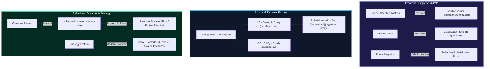
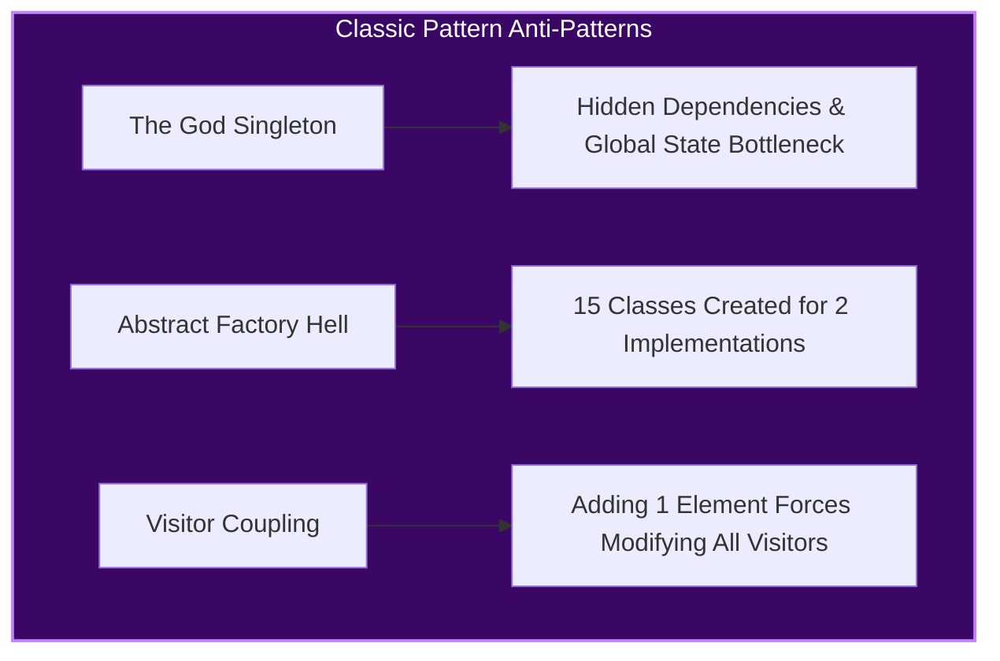
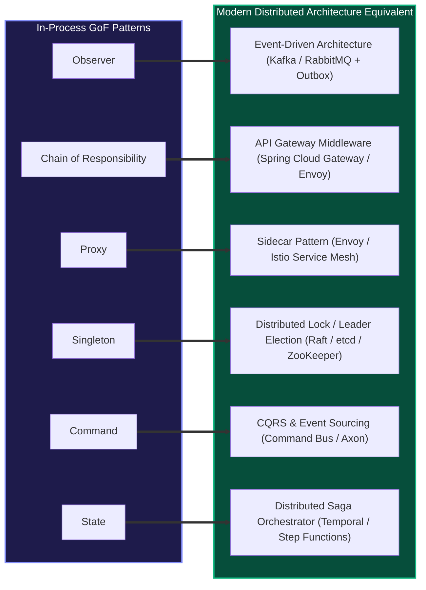

# Java Design Patterns: Overview

Design patterns are reusable solutions to common software design problems. They provide proven approaches that improve code maintainability, readability, and scalability, while establishing a shared vocabulary for developers to communicate design decisions.


## Design Patterns Quick Reference

| Pattern | Category | Complexity | Popularity |
|---------|----------|------------|------------|
| [Abstract Factory](abstract-factory) | Creational | ⭐⭐☆ (2/3) | ⭐⭐⭐ (3/3) |
| [Adapter](adapter) | Structural | ⭐☆☆ (1/3) | ⭐⭐⭐ (3/3) |
| [Bridge](bridge) | Structural | ⭐⭐⭐ (3/3) | ⭐☆☆ (1/3) |
| [Builder](builder) | Creational | ⭐⭐☆ (2/3) | ⭐⭐⭐ (3/3) |
| [Chain of Responsibility](chain-of-responsibility) | Behavioral | ⭐⭐☆ (2/3) | ⭐⭐☆ (2/3) |
| [Command](command) | Behavioral | ⭐☆☆ (1/3) | ⭐⭐⭐ (3/3) |
| [Composite](composite) | Structural | ⭐⭐☆ (2/3) | ⭐⭐☆ (2/3) |
| [Decorator](decorator) | Structural | ⭐⭐☆ (2/3) | ⭐⭐☆ (2/3) |
| [Facade](facade) | Structural | ⭐☆☆ (1/3) | ⭐⭐☆ (2/3) |
| [Factory Method](factory-method) | Creational | ⭐☆☆ (1/3) | ⭐⭐⭐ (3/3) |
| [Flyweight](flyweight) | Structural | ⭐⭐⭐ (3/3) | ⭐☆☆ (1/3) |
| [Interpreter](interpreter) | Behavioral | ⭐⭐⭐ (3/3) | ⭐☆☆ (1/3) |
| [Iterator](iterator) | Behavioral | ⭐⭐☆ (2/3) | ⭐⭐⭐ (3/3) |
| [Mediator](mediator) | Behavioral | ⭐⭐☆ (2/3) | ⭐⭐☆ (2/3) |
| [Memento](memento) | Behavioral | ⭐⭐⭐ (3/3) | ⭐☆☆ (1/3) |
| [Observer](observer) | Behavioral | ⭐⭐☆ (2/3) | ⭐⭐⭐ (3/3) |
| [Prototype](prototype) | Creational | ⭐☆☆ (1/3) | ⭐⭐☆ (2/3) |
| [Proxy](proxy) | Structural | ⭐⭐☆ (2/3) | ⭐☆☆ (1/3) |
| [Singleton](singleton) | Creational | ⭐☆☆ (1/3) | ⭐⭐☆ (2/3) |
| [State](state) | Behavioral | ⭐☆☆ (1/3) | ⭐⭐☆ (2/3) |
| [Strategy](strategy) | Behavioral | ⭐☆☆ (1/3) | ⭐⭐⭐ (3/3) |
| [Template Method](template-method) | Behavioral | ⭐☆☆ (1/3) | ⭐⭐☆ (2/3) |
| [Visitor](visitor) | Behavioral | ⭐⭐⭐ (3/3) | ⭐☆☆ (1/3) |

---

## The Three Categories

| Category | Purpose | Patterns Covered |
|----------|---------|-----------------|
| **Creational** | Control how objects are created | [Singleton](singleton), [Factory Method](factory-method), [Abstract Factory](abstract-factory), [Builder](builder), [Prototype](prototype) |
| **Structural** | Manage object composition & relationships | [Adapter](adapter), [Bridge](bridge), [Composite](composite), [Decorator](decorator), [Facade](facade), [Flyweight](flyweight), [Proxy](proxy) |
| **Behavioral** | Define how objects communicate & share responsibility | [Chain of Responsibility](chain-of-responsibility), [Command](command), [Interpreter](interpreter), [Iterator](iterator), [Mediator](mediator), [Memento](memento), [Observer](observer), [State](state), [Strategy](strategy), [Template Method](template-method), [Visitor](visitor) |

---

## Creational Patterns at a Glance

| Pattern | Complexity | Popularity | Intent | Key Mechanism |
|---------|------------|------------|--------|---------------|
| **[Abstract Factory](abstract-factory)** | ⭐⭐☆ (2/3) | ⭐⭐⭐ (3/3) | Provide an interface for creating families of related objects without specifying their concrete classes. | Factory of factories |
| **[Builder](builder)** | ⭐⭐☆ (2/3) | ⭐⭐⭐ (3/3) | Separate the construction of a complex object from its representation, allowing the same construction process to create different representations. | Fluent builder with `build()` |
| **[Factory Method](factory-method)** | ⭐☆☆ (1/3) | ⭐⭐⭐ (3/3) | Define an interface for creating objects, but let subclasses decide which class to instantiate. | Factory method returns interface type |
| **[Prototype](prototype)** | ⭐☆☆ (1/3) | ⭐⭐☆ (2/3) | Create new objects by cloning an existing instance (prototype) rather than constructing from scratch. | `clone()` method |
| **[Singleton](singleton)** | ⭐☆☆ (1/3) | ⭐⭐☆ (2/3) | Ensure a class has only one instance and provide a global point of access to it. | Private constructor + static accessor |

## Structural Patterns at a Glance

| Pattern | Complexity | Popularity | Intent | Key Mechanism |
|---------|------------|------------|--------|---------------|
| **[Adapter](adapter)** | ⭐☆☆ (1/3) | ⭐⭐⭐ (3/3) | Convert the interface of a class into another interface clients expect, allowing incompatible interfaces to work together. | Wraps adaptee, implements target |
| **[Bridge](bridge)** | ⭐⭐⭐ (3/3) | ⭐☆☆ (1/3) | Decouple an abstraction from its implementation so that the two can vary independently. | Composition linking two hierarchies |
| **[Composite](composite)** | ⭐⭐☆ (2/3) | ⭐⭐☆ (2/3) | Compose objects into tree structures to represent part-whole hierarchies, and treat individual objects and compositions uniformly. | Component interface for leaf + composite |
| **[Decorator](decorator)** | ⭐⭐☆ (2/3) | ⭐⭐☆ (2/3) | Attach additional responsibilities to an object dynamically, providing a flexible alternative to subclassing for extending functionality. | Wraps object, extends same interface |
| **[Facade](facade)** | ⭐☆☆ (1/3) | ⭐⭐☆ (2/3) | Provide a simplified, unified interface to a complex subsystem. | High-level wrapper methods |
| **[Flyweight](flyweight)** | ⭐⭐⭐ (3/3) | ⭐☆☆ (1/3) | Use sharing to support large numbers of fine-grained objects efficiently. | Flyweight pool returning existing instances |
| **[Proxy](proxy)** | ⭐⭐☆ (2/3) | ⭐☆☆ (1/3) | Provide a surrogate or placeholder for another object to control access to it. | Same interface, intercepts requests |

## Behavioral Patterns at a Glance

| Pattern | Complexity | Popularity | Intent | Key Mechanism |
|---------|------------|------------|--------|---------------|
| **[Chain of Responsibility](chain-of-responsibility)** | ⭐⭐☆ (2/3) | ⭐⭐☆ (2/3) | Pass a request along a chain of handlers. Each handler decides to process the request or pass it to the next handler. | Linked handlers with next reference |
| **[Command](command)** | ⭐☆☆ (1/3) | ⭐⭐⭐ (3/3) | Encapsulate a request as an object, thereby letting you parameterize clients with different requests, queue or log requests, and support undoable operations. | Command object with `execute()`/`undo()` |
| **[Interpreter](interpreter)** | ⭐⭐⭐ (3/3) | ⭐☆☆ (1/3) | Given a language, define a representation for its grammar along with an interpreter that uses the representation to interpret sentences in the language. | Syntax tree of rule expressions |
| **[Iterator](iterator)** | ⭐⭐☆ (2/3) | ⭐⭐⭐ (3/3) | Provide a way to access the elements of an aggregate object sequentially without exposing its underlying representation (list, stack, tree, etc.). | Iterator interface with `hasNext()`/`next()` |
| **[Mediator](mediator)** | ⭐⭐☆ (2/3) | ⭐⭐☆ (2/3) | Define an object that encapsulates how a set of objects interact. Mediator promotes loose coupling by keeping objects from referring to each other explicitly, and it lets you vary their interaction independently. | Mediator interface coordinates colleagues |
| **[Memento](memento)** | ⭐⭐⭐ (3/3) | ⭐☆☆ (1/3) | Without violating encapsulation, capture and externalize an object's internal state so that the object can be restored to this state later. | Memento stores internal state snapshot |
| **[Observer](observer)** | ⭐⭐☆ (2/3) | ⭐⭐⭐ (3/3) | Define a one-to-many dependency so that when one object changes state, all its dependents are notified and updated automatically. | Subject maintains observer list |
| **[State](state)** | ⭐☆☆ (1/3) | ⭐⭐☆ (2/3) | Allow an object to alter its behavior when its internal state changes. The object will appear to change its class. | State classes encapsulate context behaviors |
| **[Strategy](strategy)** | ⭐☆☆ (1/3) | ⭐⭐⭐ (3/3) | Define a family of algorithms, encapsulate each one, and make them interchangeable. Strategy lets the algorithm vary independently from clients that use it. | Composition with strategy interface |
| **[Template Method](template-method)** | ⭐☆☆ (1/3) | ⭐⭐☆ (2/3) | Define the skeleton of an algorithm in a superclass, letting subclasses override specific steps without changing the algorithm's structure. | Abstract class with `final` template method |
| **[Visitor](visitor)** | ⭐⭐⭐ (3/3) | ⭐☆☆ (1/3) | Represent an operation to be performed on the elements of an object structure. Visitor lets you define a new operation without changing the classes of the elements on which it operates. | Double dispatch pattern |


## Design Patterns vs Design Principles

| Concept | What It Is | Examples |
|---------|-----------|----------|
| **Design Principle** | General guideline for writing good code | SOLID, DRY, KISS, YAGNI |
| **Design Pattern** | Specific, proven solution template for a recurring problem | Singleton, Factory, Observer |

Patterns often implement one or more principles — for example, the Strategy pattern applies the **Open/Closed Principle** and **Dependency Inversion**.

---

## When to Use Design Patterns

- **DO** use patterns when you recognize a recurring design problem they solve
- **DO** use patterns to communicate intent clearly with your team
- **DON'T** force patterns into every problem — simplicity beats cleverness
- **DON'T** over-engineer with patterns when a straightforward solution works

> _"Design patterns should be used to simplify code, not to complicate it."_

---

## ⚙️ JVM & Spring Framework Runtime Engine Truth for Core Patterns

Senior engineers must know how design patterns operate at the **runtime bytecode, memory model, and framework level**.



---

### 1. The Singleton Pattern: Java Memory Model (JMM) Truth

Implementing a thread-safe Singleton in Java is one of the classic senior concurrency questions.

#### A. Double-Checked Locking (DCL) with `volatile`
```java
public class SafeDCLSingleton {
    // volatile is MANDATORY: prevents instruction reordering in the JMM
    private static volatile SafeDCLSingleton instance;

    private SafeDCLSingleton() {}

    public static SafeDCLSingleton getInstance() {
        SafeDCLSingleton localRef = instance; // Single volatile read optimization
        if (localRef == null) {
            synchronized (SafeDCLSingleton.class) {
                localRef = instance;
                if (localRef == null) {
                    instance = localRef = new SafeDCLSingleton();
                }
            }
        }
        return localRef;
    }
}
```

:::caution[Why `volatile` is Non-Negotiable in DCL]
The JVM allocates memory and constructs an object in three bytecode steps:
1. `ALLOCATE` memory on the heap.
2. `INVOKESPECIAL <init>` (run the constructor).
3. `PUTSTATIC` (write the reference pointer to the static variable).

Without `volatile`, the JIT compiler and CPU out-of-order execution engine are legally permitted to reorder steps 2 and 3 (`ALLOCATE` $\to$ `PUTSTATIC` $\to$ `INVOKESPECIAL`).
If this happens, **Thread B** can enter `getInstance()`, observe `instance != null` after step 3, and return `instance` **before step 2 (the constructor) has finished running**. Thread B now operates on a **half-initialized object**, causing silent data corruption or null pointer dereferences. The `volatile` modifier introduces a memory barrier (`StoreStore` and `StoreLoad`) that prevents this reordering.
:::

#### B. Initialization-on-Demand Holder Idiom (Cleanest Lazy Singleton)
```java
public class HolderSingleton {
    private HolderSingleton() {}

    // Inner class is NOT loaded into memory until getInstance() is called
    private static class InstanceHolder {
        // Guaranteed thread-safe by the JVM ClassLoader lock during class initialization
        private static final HolderSingleton INSTANCE = new HolderSingleton();
    }

    public static HolderSingleton getInstance() {
        return InstanceHolder.INSTANCE;
    }
}
```

#### C. Enum Singleton (Joshua Bloch's Recommendation)
```java
public enum EnumSingleton {
    INSTANCE;

    public void doWork() { /* ... */ }
}
```
- **Reflection-Proof**: `Constructor.newInstance()` explicitly checks `(clazz.getModifiers() & Modifier.ENUM) != 0` and throws `IllegalArgumentException: Cannot reflectively create enum objects`.
- **Serialization-Proof**: Java's serialization mechanism guarantees enum instances are never re-created; `readResolve()` is unnecessary.

---

### 2. The Proxy Pattern: JDK Dynamic Proxy vs. CGLIB

Spring AOP, `@Transactional`, `@Cacheable`, and Hibernate lazy loading all depend on the **Proxy Pattern**.

```java
// Spring Proxy Dispatch Pipeline
Caller -> [ Proxy Object ] -> Interceptor / Advisor -> [ Target Bean Instance ]
```

| Dimension | JDK Dynamic Proxy (`java.lang.reflect.Proxy`) | CGLIB / ByteBuddy |
|---|---|---|
| **Mechanism** | Generates runtime bytecode class (`$Proxy0`) implementing interfaces | Generates dynamic subclass of the concrete target class via ASM |
| **Interface Requirement** | **Mandatory**: Target class must implement at least one interface | **None**: Can proxy concrete classes directly |
| **Method Constraints** | Only methods declared in the interface are proxied | Cannot proxy `final` classes or override `final` methods |
| **Default in Spring Boot** | Legacy Spring Framework default | **Spring Boot 2.x/3.x default** (`spring.aop.proxy-target-class=true`) |

:::warning[The Self-Invocation Trap in Spring Proxies]
```java
@Service
public class OrderService {
    public void checkout(Order order) {
        // ❌ BUG: Calling another annotated method on 'this' directly!
        this.applyDiscount(order);
    }

    @Transactional(propagation = Propagation.REQUIRES_NEW)
    public void applyDiscount(Order order) {
        // Transaction interceptor is NEVER triggered!
    }
}
```
**Why it fails**: When an external caller calls `orderService.checkout()`, it invokes the Spring proxy. But inside `checkout()`, `this.applyDiscount()` is a direct in-process method call on the target instance, **bypassing the proxy wrapper entirely**. To fix, inject self via `ObjectProvider<OrderService>`, refactor into a separate collaborator bean, or use AspectJ compile-time weaving.
:::

---

### 3. The Observer Pattern & The Lapsed Listener Memory Leak

The GoF Observer pattern maintains a subscriber list: `subject.register(observer)`.

```java
// ❌ The Lapsed Listener Memory Leak
public class EventBus {
    private final List<EventListener> listeners = new ArrayList<>(); // Strong references!

    public void register(EventListener listener) { listeners.add(listener); }
    public void publish(Event e) { listeners.forEach(l -> l.onEvent(e)); }
}
```

**The Bug**: If `EventBus` is an application-scoped singleton and a short-lived request-scoped component registers as a listener without explicitly unregistering, the `EventBus` retains a strong reference to that component. **The Garbage Collector can never collect the component**, leading to an unrecoverable heap memory leak.

#### Production Fixes:
1. **Weak References**: Store listeners in `Collections.newSetFromMap(new WeakHashMap<>())` so garbage collection is not blocked.
2. **AutoCloseable Subscriptions**: Return a `Subscription` handle implementing `AutoCloseable` that automatically deregisters upon scope termination.
3. **Modern Reactive Streams**: Migrate to `java.util.concurrent.Flow` or Project Reactor / RxJava with explicit backpressure and lifecycle cancellation (`Disposable.dispose()`).

---

### 4. Strategy & Visitor Evolution in Modern Java 17/21

In early Java, Strategy and Visitor required massive class hierarchies. Modern Java transforms how these patterns are written:

```java
// Modern Java 8+ Strategy: Replaced by First-Class Functions
@FunctionalInterface
public interface PricingStrategy {
    BigDecimal apply(BigDecimal basePrice);
}

// Pass directly via method references or lambdas — no boilerplate classes needed!
calculator.compute(order, price -> price.multiply(BigDecimal.valueOf(0.9)));
```

```java
// Modern Java 21 Sealed Hierarchies: Replacing the Visitor Pattern
public sealed interface DomainEvent permits OrderPlaced, PaymentReceived, OrderShipped {}

public record OrderPlaced(String orderId) implements DomainEvent {}
public record PaymentReceived(String orderId, BigDecimal amount) implements DomainEvent {}
public record OrderShipped(String orderId, String trackingNumber) implements DomainEvent {}

// Exhaustive pattern matching replaces double-dispatch Visitor without touching event classes:
public String formatNotification(DomainEvent event) {
    return switch (event) {
        case OrderPlaced op      -> "Order created: " + op.orderId();
        case PaymentReceived pr  -> "Paid $" + pr.amount() + " for order " + pr.orderId();
        case OrderShipped os     -> "Shipped with tracking: " + os.trackingNumber();
    }; // Compiler enforces exhaustiveness — no default clause needed!
}
```

---

## ⚠️ Pattern Anti-Patterns & Cognitive Tax of Indirection

Every design pattern introduces **indirection** (extra layers, interfaces, and dispatch steps). If the problem doesn't warrant the indirection, the pattern becomes an **anti-pattern**.



| Anti-Pattern | How It Happens | Production Consequence | Remediation |
|---|---|---|---|
| **The God Singleton** | Using Singleton as a convenient global dumping ground for state (`GlobalConfig.getInstance()`). | Destroys unit test isolation; creates heavy multithreaded lock contention; conceals object dependencies. | Replace with constructor dependency injection of request/scoped beans. |
| **Abstract Factory Hell** | Speculatively abstracting object creation when there is only one concrete product family. | High cognitive load: developers must navigate through 5 abstract layers to read 10 lines of concrete logic. | Use simple static factory methods or direct constructors until multiple families emerge. |
| **Visitor Rigidity** | Using Visitor on an object hierarchy that changes frequently. | Violates OCP in reverse: adding one new concrete element forces modifying the `Visitor` interface and all 20 visitor classes. | Replace with Java 21 sealed hierarchies + pattern matching `switch`. |

---

## 🏛️ Senior/Staff Interview Playbook: How to Ace Design Pattern Interviews

In senior and staff system design / low-level design (LLD) interviews, patterns are evaluated through the lens of **scale, maintainability, and distributed systems realism**.

---

### Rule 1: Never Start an LLD Interview by Naming a Pattern

:::danger[The #1 Junior Mistake]
*"For this Elevator / Parking Lot / Rate Limiter problem, I'm going to use the State Pattern, Factory Pattern, and Singleton Pattern."*
:::

**Why interviewers reject this**: It proves you design for patterns rather than designing for the **problem**.
- **The Principal Approach**:
  1. Start with the **core domain entities** and their state transitions.
  2. Write clean, direct code that solves the user requirements.
  3. Identify the **axis of change** (e.g. *"Different cities have different parking fee rules"*).
  4. Only then introduce the pattern as a refactoring step: *"Since fee calculation varies by jurisdiction, let's extract a `FeeCalculationStrategy` to keep our `ParkingLot` closed for modification."*

---

### Rule 2: The Cognitive Tax of Indirection (Architectural Trade-Off Matrix)

Whenever you propose a design pattern in an interview, proactively articulate its trade-offs:

| Pattern Proposed | Flexibility Gained | Cognitive Tax & Operational Cost | When to Reject |
|---|---|---|---|
| **Strategy** | Algorithms swapped at runtime; new rules added without modifying clients. | Extra classes, interface management, indirection in stack traces. | When there is only 1 algorithm and no imminent business roadmap for another. |
| **Decorator** | Dynamically stack responsibilities without subclass explosion. | Hard to debug; order-of-wrapping bugs; difficult to remove an inner layer dynamically. | When features are mutually exclusive or can be handled with simple configuration flags. |
| **Observer** | Decouples event producers from unknown subscribers. | Non-deterministic execution order; lapsed listener memory leaks; difficult to trace call graph. | When synchronous request-reply semantics and strict ordering guarantees are required. |
| **Chain of Responsibility** | Dynamic handler pipelines; single-responsibility filtering. | Requests can fall off the end of the chain unhandled; stack trace depth bloat. | When the pipeline is fixed and never reordered or dynamically composed. |

---

### Rule 3: Mapping GoF (In-Process) to Modern Distributed/Cloud Architecture

Staff and Principal candidates distinguish themselves by demonstrating how classic GoF in-process patterns scale into **distributed cloud patterns**:



1. **Observer $\to$ Distributed Event-Driven Architecture (EDA)**:
   - In-process `List<Observer>` becomes a Kafka topic or RabbitMQ exchange.
   - Trade-off reality: Moving from in-process to distributed introduces **network partitions, out-of-order delivery, duplicate messages (at-least-once delivery)**, requiring consumer **idempotency keys** and the **Transactional Outbox Pattern**.
2. **Chain of Responsibility $\to$ API Gateway Filter Chains**:
   - In-process linked handler references become Spring Cloud Gateway or Envoy HTTP filter chains executing authentication, rate-limiting (Token Bucket), and CORS before dispatching to upstream microservices.
3. **Proxy $\to$ Service Mesh Sidecar (Envoy / Istio)**:
   - In-process interception becomes an out-of-process Sidecar container intercepting all ingress/egress network traffic, providing mTLS encryption, circuit breaking (Envoy outlier detection), and distributed tracing (`traceparent` header propagation).
4. **Singleton $\to$ Distributed Leader Election**:
   - In-process `getInstance()` becomes a Raft/etcd consensus leader lease or Redis Redlock, ensuring only one instance across a 50-node Kubernetes cluster executes scheduled batch jobs.
5. **Command $\to$ CQRS & Event Sourcing**:
   - In-process `Command.execute()` becomes an immutable Command message dispatched via Kafka/Axon to an Aggregate Root, producing immutable Domain Events appended to an append-only event store.
6. **State $\to$ Distributed Saga Orchestration**:
   - In-process state transitions become a durable workflow engine (Temporal, AWS Step Functions) coordinating multi-service distributed transactions with compensating rollback actions.

---

### Candidate Verbal Heuristics & Interview Defense Scripts

#### "Why shouldn't we use a Singleton for this shared cache or configuration?"
> **Candidate Defense Script**:
> *"Singletons introduce hidden global mutable state, making unit testing fragile because tests share state across runs and cannot run deterministically in parallel. In a multithreaded or containerized cloud environment, a JVM Singleton only guarantees uniqueness per JVM instance, not across a horizontally scaled cluster of 10 pods. Instead, I define the bean with singleton scope inside a DI container (like Spring) or use a distributed cache (like Redis) with explicit constructor injection to maintain testability and horizontal scalability."*

#### "How do you decide between Strategy and Template Method?"
> **Candidate Defense Script**:
> *"Template Method relies on inheritance: the abstract parent defines the algorithm skeleton, and subclasses override specific protected steps. This tightly couples the implementation to the superclass (the Fragile Base Class problem) and fixes the algorithm at compile-time. Strategy relies on composition: the algorithm is encapsulated in a standalone interface passed into the context object. Strategy is vastly more flexible because algorithms can be swapped dynamically at runtime or provided via lambdas. I default to Strategy unless there is a very deep, invariant lifecycle pipeline that must strictly forbid callers from modifying the execution order."*

---

### Compare Next
- [Strategy Pattern](./strategy.md)
- [Factory Method Pattern](./factory-method.md)
- [Decorator Pattern](./decorator.md)

