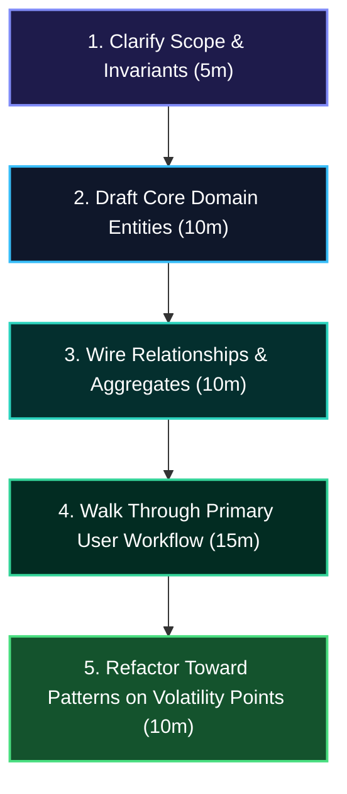

# Design Patterns Overview

> Design patterns are **reusable solutions to recurring design problems**. They are a vocabulary, not a prescription. Knowing *when not* to use a pattern is as important as knowing the pattern itself.

---

## The Gang of Four (GoF) Patterns

The 23 classic patterns from *Design Patterns: Elements of Reusable Object-Oriented Software* (Gamma et al., 1994) are organized into three categories:

| Category | Purpose | Patterns |
|----------|---------|---------|
| **Creational** | Control object creation | Singleton, Factory Method, Abstract Factory, Builder, Prototype |
| **Structural** | Compose classes/objects | Adapter, Bridge, Composite, Decorator, Facade, Flyweight, Proxy |
| **Behavioral** | Object communication | Chain of Responsibility, Command, Iterator, Mediator, Memento, Observer, State, Strategy, Template Method, Visitor |

---

## Most Commonly Asked in LLD Interviews

From most to least frequently appearing:

```
🥇 Tier 1 (Must Know — appear in almost every problem)
   Strategy, Observer, Factory, Singleton, Builder

🥈 Tier 2 (High Frequency — know well)
   Decorator, Command, State, Composite, Template Method

🥉 Tier 3 (Know the concept)
   Adapter, Facade, Proxy, Iterator, Chain of Responsibility
```

---

## How to Recognize Which Pattern to Use

| When you see... | Consider... |
|----------------|------------|
| Multiple algorithms that are interchangeable | **Strategy** |
| One event that many objects need to react to | **Observer** |
| Complex object construction with many options | **Builder** |
| Adding behavior to objects without subclassing | **Decorator** |
| A request that should be encapsulated as an object | **Command** |
| An object whose behavior changes based on internal state | **State** |
| A tree of objects (part-whole hierarchy) | **Composite** |
| An incompatible interface you can't change | **Adapter** |
| Exactly one instance of a class needed | **Singleton** |
| Subclasses decide which class to instantiate | **Factory Method** |
| A fixed algorithm with customizable steps | **Template Method** |

---

## Common Mistakes to Avoid

### ❌ Overusing Singleton
Singleton is the most misused pattern. It introduces global state and makes testing hard.

```java
// ❌ Using Singleton just because "there's only one right now"
public class DatabaseConnection {
    private static DatabaseConnection instance;
    // ... is this really a singleton? What about test isolation?
}

// ✅ Better: use dependency injection; let the DI container manage lifecycle
public class DatabaseConnection {
    private final String url;
    public DatabaseConnection(String url) { this.url = url; }
}
// Wire once in main(), inject everywhere
```

:::tip[Interview Tip 🎯]
When you mention Singleton in an interview, proactively say: *"I'd use Singleton here for X, but I'm aware of the downsides — global state makes unit testing harder. In a production codebase I'd prefer to manage this lifecycle through a DI framework."* This shows senior thinking.
:::

### ❌ Pattern Matching
Don't force a pattern onto every problem. The simplest code that expresses intent clearly is always better.

### ❌ Naming Patterns in the Name
`StrategyStrategy`, `FactoryFactory` — these suggest you're thinking about patterns instead of the domain.

---

## The Pattern Selection Framework

When you identify a design decision in an interview, ask yourself:

```
1. What VARIES in this design?
   → The variation point is where a pattern should live.

2. What STAYS THE SAME?
   → This is the stable core — protect it from change.

3. What RELATIONSHIP exists between objects?
   → is-a → inheritance/interface
   → has-a → composition
   → uses-a → dependency injection

4. What CHANGES OVER TIME?
   → State pattern for behavior changes
   → Observer for data propagation
   → Command for action history
```

---

## Pattern Combinations in Real Problems

Real systems use **multiple patterns together**. Here's how they combine in classic LLD problems:

| Problem | Patterns Used |
|---------|-------------|
| Parking Lot | Strategy (pricing), Factory (spot allocation), Observer (availability events) |
| Rate Limiter | Strategy (algorithm), Singleton (per-resource limiter) |
| Elevator | State (door/movement), Strategy (scheduling), Observer (floor requests) |
| Movie Booking | Observer (seat hold expiry), Command (book/cancel), Factory (seat types) |
| File System | Composite (file/folder tree), Iterator (traversal), Decorator (permissions) |

---

## 🏛️ Senior/Staff Interview Playbook: Mastering Pattern Trade-offs in LLD

In an LLD interview (45–60 minutes), senior and staff interviewers evaluate your **problem-solving maturity**, not your ability to cram as many GoF patterns as possible into a whiteboard.



---

### 1. The 5-Stage Senior LLD Execution Protocol

1. **Stage 1: Clarify Scope & Invariants (Minutes 0–5)**
   - Don't start drawing classes immediately. Clarify core rules:
     - *"Are rates flat, tiered, or dynamic based on vehicle weight and occupancy?"*
     - *"Is concurrency single-threaded or must we support multiple simultaneous entry gates with thread safety?"*
2. **Stage 2: Model Core Domain Entities (Minutes 5–15)**
   - Focus on state encapsulation and Rich Domain Models:
     - Keep fields `private final` by default.
     - Protect business invariants inside entity mutation methods (Tell, Don't Ask).
3. **Stage 3: Establish Relationships & Boundaries (Minutes 15–25)**
   - Prioritize **composition over inheritance** (`ParkingFloor has-a List<ParkingSpot>`).
   - Define clear aggregate roots (e.g. `ParkingLot` coordinates `ParkingFloor`s).
4. **Stage 4: Trace the Primary Happy Path (Minutes 25–40)**
   - Write out the end-to-end execution flow: `parkVehicle(Vehicle) -> Ticket`, `checkout(Ticket) -> PaymentReceipt`.
   - Ensure exceptions are handled (`SpotNotFoundException`, `InvalidTicketException`).
5. **Stage 5: Refactor Toward Patterns on Volatility Points (Minutes 40–50)**
   - Identify where requirements might diverge:
     - *"Currently we use hourly pricing. To make this extensible for weekend surcharges or EV spot pricing without touching `ParkingLot`, I will extract a `PricingStrategy` interface."*

---

### 2. The Anti-Pattern of Premature Abstraction

:::danger[The "Pattern Soup" Trap]
Interviewers immediately down-level candidates who announce: *"I'm going to use Abstract Factory, Builder, Observer, and Decorator"* before writing a single line of business logic.
:::

#### How Senior Candidates Approach Abstraction:
- **Write Concrete Code First**: Solve the problem simply and cleanly.
- **Identify the Axis of Change**: Ask: *"What is actually likely to change here?"*
- **Apply the "Rule of Three"**: If there is only one algorithm (e.g., standard FIFO queueing), do NOT create an abstract `QueueSchedulingStrategy` and 3 sub-classes unless the interviewer asks for alternative scheduling models.
- **Acknowledge the Cognitive Tax**: Every pattern adds extra interfaces, files, and dispatch layers. Proactively explain: *"I am keeping this as a simple method for now. If we introduce more discount rules, we can refactor this into a Strategy pattern."*

---

### 3. Senior Candidate Verbal Defense Scripts

#### "Why did you use Strategy instead of a simple switch statement?"
> **Candidate Defense Script**:
> *"If there are only two static cases that never change (e.g. `BUY` vs `SELL`), a modern Java `switch` statement on an `enum` or sealed type is cleaner, faster, and keeps logic co-located. However, I extracted a `PricingStrategy` interface here because pricing algorithms depend on external market data, have different mathematical complexities, and will be added by different feature teams independently. Using Strategy adheres to the Open/Closed Principle and allows dynamic runtime swapping without modifying the order processing engine."*

#### "How would this in-memory design scale to a distributed production system?"
> **Candidate Defense Script**:
> *"Right now, we are using in-process locks (`ReentrantLock`) and the Observer pattern for local notifications. In a distributed multi-node Kubernetes deployment:
> 1. The in-memory locks would be replaced by distributed locking via Redis (Redlock) or optimistic concurrency control with database row versions (`@Version`).
> 2. The local Observer pattern would transition into an event-driven Kafka or RabbitMQ topic backed by the Transactional Outbox Pattern to guarantee at-least-once message delivery."*

---

**Next →** [Creational Patterns](./creational)

