# OOP Concepts

> The four pillars of OOP are not just theory — interviewers expect you to **apply** them naturally in your class design. Here's how to think about each one.

---

## 1. Encapsulation

**Hide internal state. Expose behavior through a controlled interface.**

Encapsulation is about more than just `private` fields. It means that a class owns its data — no outside code can corrupt it.

```java
// ❌ Bad: exposes internal state directly
public class BankAccount {
    public double balance;  // Anyone can set this to -1_000_000
    public List<Transaction> transactions;
}

// ✅ Good: encapsulated
public class BankAccount {
    private double balance;
    private final List<Transaction> transactions = new ArrayList<>();

    public void deposit(double amount) {
        if (amount <= 0) throw new IllegalArgumentException("Amount must be positive");
        this.balance += amount;
        transactions.add(new Transaction(TransactionType.DEPOSIT, amount));
    }

    public void withdraw(double amount) {
        if (amount > balance) throw new InsufficientFundsException();
        this.balance -= amount;
        transactions.add(new Transaction(TransactionType.WITHDRAWAL, amount));
    }

    public double getBalance() { return balance; }

    // Returns unmodifiable view — doesn't expose internal list
    public List<Transaction> getTransactions() {
        return Collections.unmodifiableList(transactions);
    }
}
```

:::tip[Interview Tip 🎯]
When asked "why is this field `private`?", say: *"I want the class to be the sole authority over its own state. If balance were public, callers could set it to any value, bypassing validation logic."*
:::

### Tell, Don't Ask
A common encapsulation violation is **asking** an object for its data and then making decisions on its behalf. Instead, **tell** it what to do.

```java
// ❌ Tell-don't-ask violation
if (account.getBalance() >= payment.getAmount()) {
    account.setBalance(account.getBalance() - payment.getAmount());
}

// ✅ Tell the object to do it
account.withdraw(payment.getAmount()); // Account handles validation internally
```

---

## 2. Abstraction

**Show only what's necessary. Hide the complexity.**

Abstraction lets you work with concepts at a higher level without worrying about implementation details.

```java
// Abstraction via interface — callers don't care HOW notifications are sent
public interface NotificationService {
    void send(String recipient, String message);
}

// Multiple implementations hidden behind the abstraction
public class EmailNotificationService implements NotificationService {
    private final JavaMailSender mailSender;

    @Override
    public void send(String recipient, String message) {
        // Complex SMTP logic here
        MimeMessage mail = mailSender.createMimeMessage();
        // ... setup headers, body, etc.
        mailSender.send(mail);
    }
}

public class SmsNotificationService implements NotificationService {
    private final TwilioClient twilioClient;

    @Override
    public void send(String recipient, String message) {
        // Twilio API call here
        twilioClient.messages().create(recipient, FROM_NUMBER, message);
    }
}

// User of the abstraction — blissfully unaware of SMTP or Twilio
public class OrderService {
    private final NotificationService notifier;  // Depends on abstraction

    public void placeOrder(Order order) {
        processPayment(order);
        notifier.send(order.getCustomerEmail(), "Your order #" + order.getId() + " is confirmed!");
    }
}
```

:::tip[Interview Tip 🎯]
Early in LLD interviews, say: *"Before I write any class, I'd like to define the key interfaces. That way we can discuss the contract before getting into implementation details."*
:::

---

## 3. Inheritance

**Model "is-a" relationships. Reuse behavior from a parent class.**

Inheritance should represent a genuine *is-a* relationship. Misusing it is one of the most common OOP mistakes.

```java
// ✅ Good inheritance: genuine "is-a" relationships
public abstract class Vehicle {
    protected String licensePlate;
    protected int year;

    public abstract String getFuelType();

    public String describe() {
        return year + " vehicle [" + licensePlate + "], fuel: " + getFuelType();
    }
}

public class ElectricCar extends Vehicle {
    private int batteryCapacityKwh;

    @Override
    public String getFuelType() { return "Electric"; }

    public int getRange() {
        return batteryCapacityKwh * 4; // simplified
    }
}

public class GasCar extends Vehicle {
    private int engineCC;

    @Override
    public String getFuelType() { return "Gasoline"; }
}
```

### The Liskov Substitution Principle (preview)
Every subclass must be **substitutable** for its parent. If replacing a `Vehicle` with an `ElectricCar` breaks caller code, the inheritance is wrong.

```java
// ❌ LSP violation — Square "is-a" Rectangle? Not behaviorally!
public class Rectangle {
    protected int width, height;
    public void setWidth(int w) { this.width = w; }
    public void setHeight(int h) { this.height = h; }
    public int area() { return width * height; }
}

public class Square extends Rectangle {
    @Override
    public void setWidth(int w) { this.width = this.height = w; }   // side effect!
    @Override
    public void setHeight(int h) { this.width = this.height = h; }  // side effect!
}

// Caller assumptions break:
Rectangle r = new Square();
r.setWidth(5);
r.setHeight(10);
System.out.println(r.area()); // Expected 50, got 100!
```

:::note[Senior Deep Dive 🔴]
Prefer **composition over inheritance** for code reuse. Inheritance creates tight coupling between parent and child. A change to the parent can silently break all children. Use inheritance only when the is-a relationship is semantically correct AND the LSP holds.
:::

---

## 4. Polymorphism

**One interface, many implementations. Same call, different behavior.**

```java
// Shape hierarchy
public interface Shape {
    double area();
    double perimeter();
    void draw(Canvas canvas);
}

public class Circle implements Shape {
    private final double radius;
    public Circle(double radius) { this.radius = radius; }

    @Override public double area() { return Math.PI * radius * radius; }
    @Override public double perimeter() { return 2 * Math.PI * radius; }
    @Override public void draw(Canvas canvas) { canvas.drawCircle(radius); }
}

public class Rectangle implements Shape {
    private final double width, height;
    // ...
    @Override public double area() { return width * height; }
    @Override public double perimeter() { return 2 * (width + height); }
    @Override public void draw(Canvas canvas) { canvas.drawRect(width, height); }
}

// Polymorphic usage — caller doesn't need to know the concrete type
public class DrawingApp {
    private final List<Shape> shapes = new ArrayList<>();

    public void addShape(Shape shape) { shapes.add(shape); }

    public double totalArea() {
        return shapes.stream()
                     .mapToDouble(Shape::area)  // polymorphic call
                     .sum();
    }

    public void renderAll(Canvas canvas) {
        shapes.forEach(s -> s.draw(canvas));  // polymorphic call
    }
}
```

### Polymorphism Without Inheritance: Strategy Pattern
Polymorphism isn't just about class hierarchies. Functional interfaces give you polymorphism without inheritance:

```java
// Sort strategy as a functional interface
List<Employee> employees = getEmployees();

// Sort by salary
employees.sort(Comparator.comparingDouble(Employee::getSalary));

// Sort by name
employees.sort(Comparator.comparing(Employee::getName));

// Sort by department then by salary
employees.sort(Comparator.comparing(Employee::getDepartment)
                         .thenComparingDouble(Employee::getSalary));
```

---

## OOP in Practice: The Vehicle Rental System

Let's apply all four pillars to a mini-system:

```java
// Abstraction: what can a rentable vehicle do?
public interface Rentable {
    boolean isAvailable();
    void reserve(Customer customer, LocalDate from, LocalDate to);
    double calculateRentalCost(long days);
}

// Encapsulation + Inheritance: Vehicle base class
public abstract class Vehicle implements Rentable {
    private final String vin;        // immutable identifier
    private final String model;
    private VehicleStatus status;    // encapsulated state
    private Customer currentRenter;

    protected Vehicle(String vin, String model) {
        this.vin = vin;
        this.model = model;
        this.status = VehicleStatus.AVAILABLE;
    }

    @Override
    public boolean isAvailable() {
        return status == VehicleStatus.AVAILABLE;
    }

    @Override
    public void reserve(Customer customer, LocalDate from, LocalDate to) {
        if (!isAvailable()) throw new VehicleNotAvailableException(vin);
        this.status = VehicleStatus.RESERVED;
        this.currentRenter = customer;
    }

    // Abstract: each vehicle type calculates cost differently
    @Override
    public abstract double calculateRentalCost(long days);
}

// Concrete types with polymorphic cost calculation
public class Economy extends Vehicle {
    private static final double DAILY_RATE = 29.99;
    @Override
    public double calculateRentalCost(long days) {
        return days * DAILY_RATE;
    }
}

public class SUV extends Vehicle {
    private static final double DAILY_RATE = 79.99;
    private static final double INSURANCE_PER_DAY = 12.00;
    @Override
    public double calculateRentalCost(long days) {
        return days * (DAILY_RATE + INSURANCE_PER_DAY);
    }
}
```

---

## Interview Cheat Sheet

| Pillar | One-liner | Interview phrase |
|--------|-----------|-----------------|
| Encapsulation | Hide state, expose behavior | *"I'll make this private and expose a method that enforces invariants."* |
| Abstraction | Program to interfaces | *"Let me define the interface first before we discuss implementations."* |
| Inheritance | is-a relationships | *"I'd use composition here — this is a has-a, not an is-a."* |
| Polymorphism | One call, many behaviors | *"Because this uses an interface, I can swap implementations without changing this code."* |

---

## 🏛️ Senior/Staff Interview Playbook: Passing OOP in Senior Interviews

Senior and staff interviewers evaluate OOP through the lens of **domain integrity, concurrency safety, and long-term maintenance costs**. They actively look for candidates who transcend textbook definitions and understand modern enterprise OOP realities.

```mermaid
flowchart TD
    subgraph JuniorOOP["Junior Mindset (Textbook OOP)"]
        J1["Deep Class Hierarchies (extends)"] --> J2["Getters/Setters for All Fields"]
        J2 --> J3["Anemic Domain Models (Logic in Services)"]
        J3 --> J4["Mutable Shared State & Leaked References"]
    end

    subgraph SeniorOOP["Senior/Staff Mindset (Modern Enterprise OOP)"]
        S1["Composition over Inheritance (has-a)"] --> S2["Rich Domain Entities (Invariant Protection)"]
        S2 --> S3["Immutability by Default (Records & Value Objects)"]
        S3 --> S4["Sealed Hierarchies & Pattern Matching (Java 17/21)"]
    end

    style JuniorOOP fill:#1e1b4b,stroke:#f43f5e,stroke-width:2px,color:#fff
    style SeniorOOP fill:#064e3b,stroke:#10b981,stroke-width:2px,color:#fff
```



---

### 1. Modern OOP: Data-Oriented Programming (Java 17/21)

Classical OOP combined state and logic into heavy mutable classes. Modern production Java leverages **Data-Oriented Programming (DOP)**:

```java
// Modern Java 17/21: Model state with immutable records and sealed algebraic types
public sealed interface PaymentMethod permits CreditCard, BankTransfer, CryptoWallet {}

public record CreditCard(String cardNumber, YearMonth expiry, String cvv) implements PaymentMethod {
    public CreditCard {
        // Compact constructor enforces validation invariants at creation time
        Objects.requireNonNull(cardNumber, "Card number cannot be null");
        if (expiry.isBefore(YearMonth.now())) {
            throw new IllegalArgumentException("Card is expired");
        }
    }
}

public record BankTransfer(String iban, String swift) implements PaymentMethod {}
public record CryptoWallet(String walletAddress, NetworkType network) implements PaymentMethod {}

// Polymorphic dispatch via exhaustive pattern matching switch (compiler-enforced):
public String processPayment(PaymentMethod method, BigDecimal amount) {
    return switch (method) {
        case CreditCard cc     -> "Charging card ending in " + cc.cardNumber().substring(12);
        case BankTransfer bt   -> "Initiating SEPA wire to " + bt.iban();
        case CryptoWallet cw   -> "Transacting on " + cw.network() + " to " + cw.walletAddress();
    }; // No default branch needed: sealed hierarchy guarantees exhaustiveness at compile time
}
```

---

### 2. The Anemic Domain Model vs. Rich Domain Model Trap

:::caution[The #1 Interview Architecture Trap]
Junior candidates often write **Anemic Domain Models** (Martin Fowler anti-pattern): classes containing only private fields, getters, and setters, while services handle all validation, mutation, and calculations.
:::

```java
// ❌ Anemic Model Anti-Pattern: BankAccount is a passive data bucket
public class AnemicAccount {
    private BigDecimal balance;
    public BigDecimal getBalance() { return balance; }
    public void setBalance(BigDecimal balance) { this.balance = balance; }
}

// Service is forced to manage invariants, causing logic duplication across multiple callers:
public class AccountService {
    public void withdraw(AnemicAccount acc, BigDecimal amount) {
        if (acc.getBalance().compareTo(amount) >= 0) {
            acc.setBalance(acc.getBalance().subtract(amount)); // Invariant not protected by entity!
        }
    }
}

// ✅ Rich Domain Model: Entity owns its invariants and enforces transactional boundaries
public class RichAccount {
    private final AccountId id;
    private BigDecimal balance;
    private final List<TransactionRecord> ledger = new ArrayList<>();

    public RichAccount(AccountId id, BigDecimal initialDeposit) {
        this.id = Objects.requireNonNull(id);
        this.balance = Objects.requireNonNull(initialDeposit);
    }

    // Encapsulation + Tell-Don't-Ask: State mutation is strictly guarded
    public synchronized TransactionReceipt withdraw(BigDecimal amount) {
        if (amount.compareTo(BigDecimal.ZERO) <= 0) {
            throw new IllegalArgumentException("Withdrawal amount must be positive");
        }
        if (this.balance.compareTo(amount) < 0) {
            throw new InsufficientFundsException("Account " + id + " has insufficient funds");
        }
        this.balance = this.balance.subtract(amount);
        TransactionRecord record = new TransactionRecord(TransactionType.DEBIT, amount, Instant.now());
        ledger.add(record);
        return new TransactionReceipt(id, record.id(), this.balance);
    }

    // Defensive copy prevents outside callers from mutating internal state
    public List<TransactionRecord> getLedger() {
        return List.copyOf(ledger);
    }
}
```

---

### 3. The Fragile Base Class Problem & Defensive Copying

#### The Fragile Base Class Gotcha
When a parent class alters internal method dispatch, subclasses break invisibly:

```java
// Parent class in 3rd-party library:
public class InstrumentedSet<E> extends HashSet<E> {
    private int addCount = 0;

    @Override
    public boolean add(E e) {
        addCount++;
        return super.add(e);
    }

    @Override
    public boolean addAll(Collection<? extends E> c) {
        addCount += c.size();
        return super.addAll(c); // ⚠️ HashSet.addAll() internally calls this.add()!
    }
}
// Calling addAll(List.of("A", "B", "C")) results in addCount = 6 (double-counted)!
```

> **Senior Rule**: *Design and document for inheritance, or else prohibit it.* Mark classes `final` unless explicitly intended for subclassing. Prefer **forwarding / decorator composition** instead.

#### Defensive Copying
Never return raw references to mutable collections or date objects:
```java
// ❌ Exposing internal collection: outside callers can clear() or add() directly!
public List<Item> getItems() { return this.items; }

// ✅ Java 10+ Immutable snapshot: guarantees true immutability
public List<Item> getItems() { return List.copyOf(this.items); }
```

---

### 4. Senior Candidate Verbal Defense Scripts

#### "Why shouldn't I generate Getters and Setters for all fields?"
> **Candidate Defense Script**:
> *"Generating indiscriminate getters and setters strips the entity of encapsulation, degrading it into an Anemic Domain Model. When external classes can arbitrarily invoke setters, business invariants are scattered across service layers rather than protected at the aggregate root. I provide getters only for data callers genuinely need, and expose intention-revealing business methods—like `order.cancel(reason)` rather than `order.setStatus('CANCELLED')`—to ensure state transitions remain valid and audited."*

#### "How do you explain Polymorphism without class inheritance?"
> **Candidate Defense Script**:
> *"Polymorphism means 'many forms'—it is about uniform interfaces, not class inheritance trees. In modern Java, we achieve polymorphism through interface implementation, higher-order functions (passing `@FunctionalInterface` lambdas as Strategy arguments), and Java 17/21 sealed interface pattern matching. Composition with interfaces decouples clients from concrete implementations without the brittle coupling of class inheritance."*

---

**Next →** [Design Principles (SOLID)](./principles)

