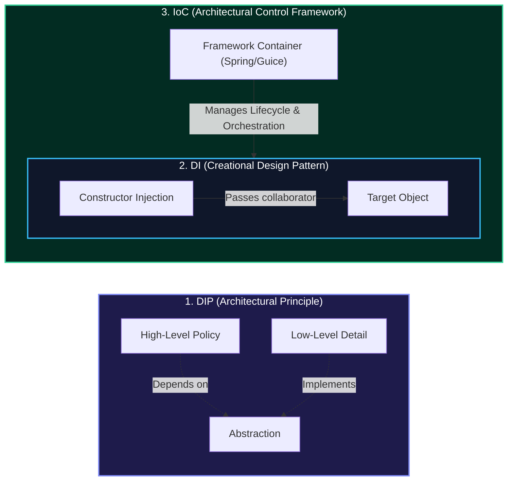

# Design Principles

> Principles are **heuristics**, not laws. Know them deeply enough to know when to break them — and be able to explain why.

---

## SOLID Principles

SOLID is an acronym for five principles that make object-oriented designs more maintainable, flexible, and testable.

---

### S — Single Responsibility Principle (SRP)

> **A class should have only one reason to change.**

"Reason to change" = stakeholder/actor whose requirements drive that change.

```java
// ❌ Violates SRP: three different reasons to change
public class Employee {
    public double calculatePay() { /* Finance team owns this */ }
    public String generateReport() { /* HR team owns this */ }
    public void saveToDatabase() { /* DBA owns this */ }
}

// ✅ Three separate classes, each with one responsibility
public class PayrollCalculator {
    public double calculatePay(Employee employee) {
        return employee.getHoursWorked() * employee.getHourlyRate();
    }
}

public class EmployeeReporter {
    public String generateReport(Employee employee) {
        return String.format("Employee: %s, Dept: %s", employee.getName(), employee.getDept());
    }
}

public class EmployeeRepository {
    private final DataSource dataSource;
    public void save(Employee employee) { /* JDBC logic */ }
    public Optional<Employee> findById(long id) { /* JDBC logic */ }
}
```

:::tip[Interview Tip 🎯]
SRP is the first thing interviewers look for. If they see you put `calculatePrice()`, `sendEmail()`, and `saveToDb()` in one class, it's an immediate red flag. Split responsibilities early.
:::

---

### O — Open/Closed Principle (OCP)

> **Open for extension, closed for modification.**

Add new behavior by adding new code — not by changing existing, tested code.

```java
// ❌ Every new discount type requires modifying this class
public class PriceCalculator {
    public double calculate(Order order, String discountType) {
        double price = order.getBasePrice();
        if ("SEASONAL".equals(discountType)) {
            price *= 0.9;
        } else if ("LOYALTY".equals(discountType)) {
            price *= 0.85;
        } else if ("EMPLOYEE".equals(discountType)) {  // new requirement → modify class
            price *= 0.7;
        }
        return price;
    }
}

// ✅ Add new discount types without touching PriceCalculator
@FunctionalInterface
public interface DiscountStrategy {
    double apply(double basePrice);
}

public enum Discounts implements DiscountStrategy {
    SEASONAL  (p -> p * 0.90),
    LOYALTY   (p -> p * 0.85),
    EMPLOYEE  (p -> p * 0.70),  // new — no existing code modified
    VIP       (p -> p * 0.60);  // new — no existing code modified

    private final DiscountStrategy strategy;
    Discounts(DiscountStrategy s) { this.strategy = s; }

    @Override
    public double apply(double basePrice) { return strategy.apply(basePrice); }
}

public class PriceCalculator {
    public double calculate(Order order, DiscountStrategy discount) {
        return discount.apply(order.getBasePrice());  // closed for modification
    }
}
```

:::note[Senior Deep Dive 🔴]
OCP doesn't mean *never* modify existing code. It means that for a given *axis of variation* (e.g., discount types), you should be able to add new variants without touching the core logic. Identify the axes of variation in your design and apply OCP there.
:::

---

### L — Liskov Substitution Principle (LSP)

> **Subtypes must be substitutable for their base types without altering any of the desirable properties of the program (correctness, task performed, etc.).**
> *(Barbara Liskov & Jeannette Wing, 1994)*

If `S` extends `T`, then anywhere a `T` is used, an `S` must work correctly — without caller code needing `instanceof` checks, type casts, or surprise exceptions.

#### The Formal Behavioral Subtyping Rules (Liskov & Wing Contract)

1. **Preconditions Cannot Be Strengthened**: A subtype cannot require stricter input conditions than its supertype (e.g., if supertype accepts any `int`, subtype cannot require `int > 0`).
2. **Postconditions Cannot Be Weakened**: A subtype cannot guarantee less than its supertype (e.g., if supertype guarantees a non-null return, subtype cannot return `null`).
3. **Class Invariants Must Be Preserved**: All conditions that are always true for the supertype must remain true for the subtype.
4. **History Constraint (Rule)**: A subtype must not introduce state mutations that would be impossible in the supertype (e.g., if a supertype is designed to be immutable, a subtype must not introduce mutating methods).
5. **Exception Covariance**: Subtype methods can only throw checked exceptions that are identical to or subclasses of exceptions declared by the supertype method (or throw fewer checked exceptions).
6. **Return Type Covariance**: Subtypes may return a narrower (more specific) type than the supertype method, but never a broader type.

---

#### Classic Trap 1: The Square vs. Rectangle Geometry Paradox

In mathematics, a Square **is a** Rectangle. In object-oriented programming, **it is not** — because their mutation behaviors conflict.

```java
// ❌ The Classic Geometry Trap: Square extends Rectangle
public class Rectangle {
    private int width;
    private int height;

    public void setWidth(int width) { this.width = width; }
    public void setHeight(int height) { this.height = height; }
    public int getWidth() { return width; }
    public int getHeight() { return height; }
    public int getArea() { return width * height; }
}

public class Square extends Rectangle {
    @Override
    public void setWidth(int width) {
        super.setWidth(width);
        super.setHeight(width); // Enforcing square invariant alters height unexpectedly
    }

    @Override
    public void setHeight(int height) {
        super.setWidth(height);
        super.setHeight(height); // Enforcing square invariant alters width unexpectedly
    }
}

// Client method relying on Rectangle's contract:
public class GeometryService {
    public void resizeAndVerify(Rectangle rect) {
        rect.setWidth(5);
        rect.setHeight(4);
        // Postcondition guarantee: width == 5, height == 4, area == 20
        assert rect.getArea() == 20 : "LSP Violation! Expected 20, got " + rect.getArea();
        // If rect is a Square: setHeight(4) overwrote width to 4!
        // rect.getArea() yields 16. Assertion fails, breaking program correctness.
    }
}
```

```java
// ✅ Architectural Fix: Model by capability, favor immutability or separate interfaces
public sealed interface Shape permits Rectangle, Square {
    int getArea();
}

public record Rectangle(int width, int height) implements Shape {
    @Override
    public int getArea() { return width * height; }
    public Rectangle withWidth(int newWidth) { return new Rectangle(newWidth, this.height); }
    public Rectangle withHeight(int newHeight) { return new Rectangle(this.width, newHeight); }
}

public record Square(int side) implements Shape {
    @Override
    public int getArea() { return side * side; }
    public Square withSide(int newSide) { return new Square(newSide); }
}
```

---

#### Classic Trap 2: ReadOnly Collections vs. The JDK Trade-Off

```java
// ❌ ReadOnlyList "is-a" List? Behaviorally no.
public class ReadOnlyList<E> extends ArrayList<E> {
    @Override
    public boolean add(E e) {
        throw new UnsupportedOperationException("Read-only collection!"); // Breaks postcondition
    }
}

// Any caller passing List<T> expects add() to mutate the list:
void processData(List<String> list) {
    list.add("processed"); // Throws at runtime if passed ReadOnlyList!
}
```

:::note[Architectural Reality: Did the JDK Violate LSP? 🔴]
**Yes.** `Collections.unmodifiableList(list).add(...)` throws `UnsupportedOperationException`. Why did Joshua Bloch and the Sun Java architects do this in Java 1.2?
- **The Pragmatic Trade-off**: Splitting `Collection` into `ReadableCollection`, `AppendableCollection`, `MutableCollection`, etc., would have caused a combinatorial **interface explosion** (15+ extra interfaces) and broken backwards compatibility with Java 1.0/1.1 `Vector` and `Hashtable`.
- **Modern Alternative**: Modern languages (like Kotlin or Scala) distinguish `List` (read-only interface) from `MutableList` at the type system level, preventing this runtime exception entirely.
:::

---

### I — Interface Segregation Principle (ISP)

> **Clients should not be forced to depend on interfaces they don't use.**

Fat interfaces create tight coupling — split them by client need.

```java
// ❌ One fat interface forces implementors to implement irrelevant methods
public interface Animal {
    void eat();
    void sleep();
    void fly();    // Dogs have to implement this?!
    void swim();   // Eagles have to implement this?!
    void run();
}

public class Dog implements Animal {
    @Override public void eat() { System.out.println("Nom nom"); }
    @Override public void sleep() { System.out.println("Zzz"); }
    @Override public void fly() { throw new UnsupportedOperationException(); }  // 🤢
    @Override public void swim() { System.out.println("Splashing"); }
    @Override public void run() { System.out.println("Running"); }
}
```

```java
// ✅ Segregated interfaces — implement only what makes sense
public interface Eatable  { void eat(); }
public interface Sleepable { void sleep(); }
public interface Flyable  { void fly(); }
public interface Swimmable { void swim(); }
public interface Runnable { void run(); }

public class Dog implements Eatable, Sleepable, Swimmable, Runnable {
    @Override public void eat()   { System.out.println("Nom nom"); }
    @Override public void sleep() { System.out.println("Zzz"); }
    @Override public void swim()  { System.out.println("Splashing"); }
    @Override public void run()   { System.out.println("Running"); }
    // No fly() — doesn't need it!
}

public class Eagle implements Eatable, Sleepable, Flyable {
    @Override public void eat()   { System.out.println("Hunting"); }
    @Override public void sleep() { System.out.println("Zzz"); }
    @Override public void fly()   { System.out.println("Soaring"); }
}
```

:::tip[Interview Tip 🎯]
When designing interfaces in an LLD interview, ask yourself: *"Is there a client that would use every method in this interface?"* If not, it's a candidate for splitting.
:::

---

### D — Dependency Inversion Principle (DIP)

> **Depend on abstractions, not concretions. High-level modules should not depend on low-level modules.**

```java
// ❌ High-level OrderService depends on low-level MySQLOrderRepository
public class OrderService {
    private MySQLOrderRepository repository = new MySQLOrderRepository(); // concrete!
    private SmtpEmailSender emailSender = new SmtpEmailSender();           // concrete!

    public void placeOrder(Order order) {
        repository.save(order);
        emailSender.send(order.getCustomer().getEmail(), "Order confirmed!");
    }
}
// Now switching from MySQL to PostgreSQL requires changing OrderService!
```

```java
// ✅ OrderService depends on abstractions — injected via constructor
public interface OrderRepository {
    void save(Order order);
    Optional<Order> findById(String id);
}

public interface EmailSender {
    void send(String to, String subject, String body);
}

public class OrderService {
    private final OrderRepository repository;  // abstraction
    private final EmailSender emailSender;     // abstraction

    // Dependencies are INJECTED — OrderService doesn't create them
    public OrderService(OrderRepository repository, EmailSender emailSender) {
        this.repository = repository;
        this.emailSender = emailSender;
    }

    public void placeOrder(Order order) {
        repository.save(order);
        emailSender.send(order.getCustomerEmail(), "Order Confirmed", buildBody(order));
    }
}

// Wiring (in your main / DI container):
OrderRepository repo     = new PostgreSQLOrderRepository(dataSource);
EmailSender    mailer   = new SmtpEmailSender(smtpConfig);
OrderService   service  = new OrderService(repo, mailer);
// Swap PostgreSQL for Mongo? Change one line here, OrderService unchanged.
```

:::note[Senior Deep Dive 🔴]
DIP is why **dependency injection** frameworks (Spring, Guice) exist. In an interview without a framework, demonstrate DIP manually through constructor injection. Avoid `new` inside business logic classes — say: *"I'd inject this dependency through the constructor to keep this class testable and decoupled."*
:::

---

## Additional Principles

### DRY — Don't Repeat Yourself

Every piece of knowledge should have a **single, authoritative representation**.

```java
// ❌ DRY violation: magic number 0.08 repeated everywhere
double tax1 = price1 * 0.08;
double tax2 = price2 * 0.08;
double tax3 = price3 * 0.08;

// ✅ Single source of truth
public class TaxCalculator {
    private static final double TAX_RATE = 0.08; // one place to change

    public double calculate(double price) {
        return price * TAX_RATE;
    }
}
```

### KISS — Keep It Simple, Stupid

The simplest solution that works is usually the best. Don't over-engineer.

```java
// ❌ Over-engineered for a simple task
public class StringReverser {
    private final StringReversingAlgorithmFactory factory;
    private final StringReversingStrategy strategy;
    // ... 50 lines of code

    public String reverse(String s) {
        return strategy.reverse(s);
    }
}

// ✅ KISS
public String reverse(String s) {
    return new StringBuilder(s).reverse().toString();
}
```

### YAGNI — You Aren't Gonna Need It

Don't implement features until they're actually needed.

:::tip[Interview Tip 🎯]
When an interviewer asks "what if we need to support X in the future?", a great answer is: *"I'd design the interface so it's easy to add X without breaking existing code, but I wouldn't implement X now since it's not in the current requirements. This keeps our codebase lean and the design focused."*
:::

---

## SOLID Quick Reference

| Principle | Violation Signal | Architectural Fix |
|---|---|---|
| **SRP** *(Single Responsibility)* | Class has multiple `import` groups from different domains or multiple actors drive changes | Extract classes by actor/responsibility or aggregate boundary |
| **OCP** *(Open/Closed)* | `if/switch` on type tag that grows over time | Replace with polymorphism, Strategy pattern, or sealed hierarchies |
| **LSP** *(Liskov Substitution)* | `instanceof` checks, `UnsupportedOperationException` in overrides | Redesign the hierarchy; split mutable/readable roles; use composition |
| **ISP** *(Interface Segregation)* | Implementing an interface with `throw new UnsupportedOperationException()` | Split the fat interface into focused role interfaces |
| **DIP** *(Dependency Inversion)* | `new ConcreteClass()` inside business logic | Constructor-inject an interface or abstraction |

---

## 🏛️ Senior/Staff Interview Playbook: How to Ace SOLID & OOP in Senior Interviews

In senior, staff, and principal engineering interviews, interviewers are **not** checking whether you can recite the five SOLID definitions. They are assessing your **architectural judgment**: do you understand the trade-offs, cognitive tax, and operational realities of these principles, and do you know **when to intentionally violate them**?

```mermaid
flowchart TD
    subgraph JuniorMid["Junior & Mid-Level Mindset (Dogmatic)"]
        J1["Recites SOLID Acronyms"] --> J2["Forces Every Class into Interfaces"]
        J2 --> J3["Speculative Generality (YAGNI Violation)"]
        J3 --> J4["Fragmented, Over-Abstracted Codebase"]
    end

    subgraph StaffPrincipal["Senior & Staff Mindset (Pragmatic & Context-Driven)"]
        S1["Volatility Analysis (Identify Axis of Change)"] --> S2["Locality of Behavior & Cohesion"]
        S2 --> S3["Apply Patterns Only When Variance Emerges"]
        S3 --> S4["Balanced Design (Minimal Cognitive Tax)"]
    end

    style JuniorMid fill:#1e1b4b,stroke:#f43f5e,stroke-width:2px,color:#fff
    style StaffPrincipal fill:#064e3b,stroke:#10b981,stroke-width:2px,color:#fff
```



---

### 1. How Principal Interviewers Actually Grade Candidates

| Level | Mental Model | Typical Response in an LLD Interview | Interviewer Evaluation |
|---|---|---|---|
| **Junior / Mid** | Dogmatic adherence | *"I will create `OrderService`, `IOrderService`, `OrderRepository`, `IOrderRepository`, `OrderValidator`, `IOrderValidator`, `OrderEmailer`, `IOrderEmailer`, and a factory."* | ⚠️ Flags over-engineering, high cognitive tax, speculative abstractions. |
| **Senior / Staff** | Pragmatic trade-offs | *"For now, `Order` enforces its internal line-item invariants as a DDD aggregate. I will keep persistence decoupled via an `OrderRepository` abstraction because storage may vary, but I won't extract interfaces for `OrderService` until multiple implementations or testing mocking require it."* | ✅ Strong hire. Understands cohesion, locality of behavior, and maintenance costs. |

---

### 2. When to Intentionally Violate SRP (Single Responsibility)

The most common mistake junior developers make is treating SRP as *"one class per method or action"*, resulting in **class explosion** and destroying **Locality of Behavior**.

#### Architectural Justifications to Violate Strict SRP:
1. **Domain-Driven Design (DDD) Aggregates & Invariant Protection**:
   - An Aggregate Root (e.g. `Order`) must encapsulate both its internal state (`List<OrderLine>`) and the business invariants (e.g., maximum line item limits, discount caps, status transitions).
   - If you split discount calculation, tax calculation, and item validation into three separate services that directly mutate the `Order`, you break **encapsulation** and risk leaving the aggregate in an invalid state.
2. **Transactional Boundaries & Partial Failures**:
   - If operations must execute within a single atomic database transaction, scattering them across 10 micro-classes increases the risk of fragmented transactions, detached entities, and Hibernate `LazyInitializationException`s.
3. **High-Throughput Performance & CPU Cache Locality**:
   - Splitting a tightly-coupled data structure into 8 delegated helper objects creates heavy pointer chasing, increases heap allocation, and stresses GC throughput. Co-locating related state and routines in a single class maximizes L1/L2 CPU cache hits.

---

### 3. When to Intentionally Violate OCP (Open/Closed Principle)

OCP states code should be open for extension but closed for modification. However, creating extension points introduces **indirection, boilerplate, and maintenance overhead**.

#### Architectural Justifications to Violate Strict OCP:
1. **The "Rule of Three" in Refactoring**:
   - Never introduce an abstract factory or strategy pattern for a single implementation on the premise that *"we might need another payment gateway someday"*.
   - Write concrete code for the first case. When the second case arrives, evaluate similarity. When the **third case** arrives, refactor to an abstraction (Strategy/Factory). Premature OCP is the leading cause of speculative generality.
2. **Sealed Algebraic Data Types in Java 17/21**:
   - Sometimes an architecture **must be closed to extension** by design. If you are modeling payment states (`Pending`, `Authorized`, `Captured`, `Failed`), you want compiler-enforced exhaustiveness via `sealed interface PaymentState permits ...`.
   - Modifying a `switch` expression when a new state is added is vastly safer than allowing arbitrary uncontrolled subclasses across the codebase.

---

### 4. Interface Segregation (ISP) vs. Interface Explosion

#### The Problem: Micro-Interface Hell
If taken to the extreme, ISP yields dozens of single-method interfaces:
```java
// ❌ Interface Explosion Anti-Pattern
public interface EntityCreator<T> { void create(T entity); }
public interface EntityReader<T>  { T read(String id); }
public interface EntityUpdater<T> { void update(T entity); }
public interface EntityDeleter<T> { void delete(String id); }
```
This forces developers to maintain dozens of types, bloats dependency injection graphs, and obscures the domain intent.

#### The Senior Balance: Role Interfaces
- Design interfaces around **client usage roles**, not mathematical single methods.
- Leverage **Java 8+ `default` methods**: When adding non-mandatory behavior to an interface, provide a default method rather than breaking all implementors or creating parallel `MyInterface2` classes.
- Group by consumer needs: A `ReadOnlyRepository` and a `ReadWriteRepository` are great role-based boundaries.

---

### 5. The Architecture Triad: DIP vs. DI vs. IoC

One of the most frequently failed senior interview questions is articulating the exact boundaries between DIP, DI, and IoC.



| Concept | Nature | Definition | Core Purpose | Concrete Example |
|---|---|---|---|---|
| **DIP** *(Dependency Inversion Principle)* | **Architectural Principle** | High-level modules should not depend on low-level modules; both should depend on abstractions. | Decouples business rules from infrastructure (databases, networks). | `OrderService` depends on `PaymentGateway` interface, not `StripeClient`. |
| **DI** *(Dependency Injection)* | **Design Pattern / Technique** | Collaborators are supplied to an object from the outside rather than created internally via `new`. | Enables testability, modularity, and runtime substitution. | `public OrderService(PaymentGateway gw) { this.gw = gw; }` |
| **IoC** *(Inversion of Control)* | **Architectural Runtime Framework** | Inversion of execution flow control (the **Hollywood Principle**: *"Don't call us, we'll call you"*). | Automates lifecycle management, dependency wiring, thread pools, and interception. | Spring's `ApplicationContext` instantiates beans, executes `@PostConstruct`, injects `@Autowired` references, and wraps beans in AOP proxies. |

---

### 6. Classic Interview Traps & Quick Defense Scripts

#### Trap 1: "Why don't you create an interface for every single service?"
> **Candidate Defense Script**:
> *"In Java/Spring development, creating `OrderService` and `OrderServiceImpl` for a class that has only one implementation is an obsolete convention from Spring 1.x (when JDK Dynamic Proxies required interfaces). Today, CGLIB and ByteBuddy can proxy concrete classes directly. Unless I anticipate multiple runtime implementations (e.g., in-memory vs database) or need to decouple across independent team/module boundaries, creating single-implementation interfaces adds pure indirection with zero polymorphism benefits. I adhere to YAGNI and extract the interface when the second implementation arises."*

#### Trap 2: "Is `Collections.unmodifiableList()` in the JDK a violation of LSP?"
> **Candidate Defense Script**:
> *"Yes, it is a textbook violation of the Liskov Substitution Principle. The parent type `List<E>` guarantees mutating operations like `.add()`, but calling `.add()` on `unmodifiableList()` throws an `UnsupportedOperationException` at runtime, violating the postcondition contract. Joshua Bloch and Sun Microsystems intentionally chose this compromise in Java 1.2 to avoid doubling the size of the collections hierarchy with separate read-only and mutable interface trees. Modern languages like Kotlin correct this at compile-time by separating `List` from `MutableList`."*

#### Trap 3: "Why prefer Composition over Inheritance?"
> **Candidate Defense Script**:
> *"Inheritance violates encapsulation because subclasses are coupled to the parent class's internal implementation details (the Fragile Base Class problem). If a parent class refactors its internal method dispatch—such as `addAll()` internally invoking `add()`—a subclass overriding both will double-count elements. Furthermore, inheritance is static (compile-time locked), while composition allows dynamic, runtime swappable behavior via delegation."*

---

**Next →** [Design Patterns Overview](../design-patterns/overview)

