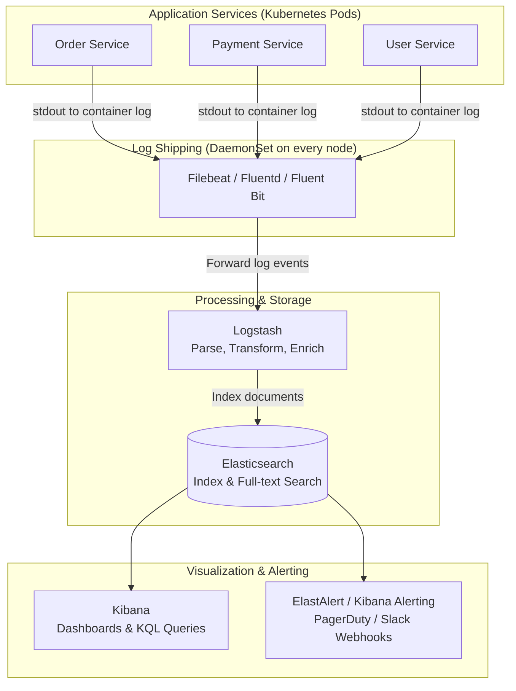
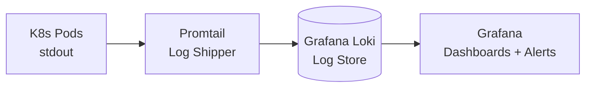
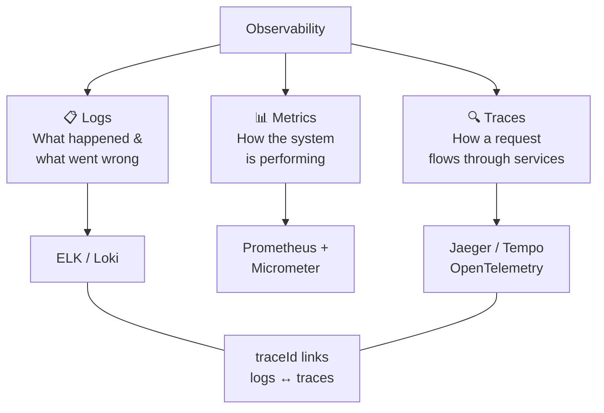

# Log Aggregation

**Log Aggregation** is the practice of collecting, centralizing, indexing, and searching log output from every service in a distributed system in one place — so that engineers can trace a user request across 20 microservices in seconds instead of hours.

> **The core problem it solves:** In a microservices architecture, a single user request touches many services running on ephemeral containers. By the time you discover a bug, the container that handled the request may have been restarted 10 times. **Logs must flow to a central store before the container dies.**

---

## 👶 Beginner: Why You Can't `grep` Logs in Microservices

In a monolith, all logs live on one server. You `ssh` in, `tail -f app.log`, and you see everything. In microservices:

```text
User reports: "My order #12345 failed at 10:15am"

WITHOUT Log Aggregation:
Step 1: Which of 30 Order Service pods handled that request? (pods are named randomly)
Step 2: kubectl exec into it... container was restarted at 10:20am. Logs are gone.
Step 3: Check Payment Service... which of 15 pods? Running on 4 nodes.
Step 4: Was it the Stripe integration? Let me check 8 Payment Service pods...
→ Debugging time: 4 hours. Incident still open.

WITH Log Aggregation (Kibana):
Search: service:"order-service" AND orderId:"12345" AND @timestamp:[10:10 TO 10:20]
→ Full trace of the request across all 30 Order Service pods AND Payment Service.
→ Debugging time: 4 minutes. Incident resolved.
```

---

## 🏗️ Architecture: The ELK/EFK Stack

The two most common architectures:



### Component Responsibilities

| Component | Role | Why not skip it? |
| :--- | :--- | :--- |
| **Fluent Bit** (preferred) | Ultra-lightweight log shipper (< 1MB memory). Runs as a DaemonSet on every K8s node. Tails container stdout/stderr. | Without it, logs stay on the node's disk — lost on restart |
| **Logstash** | Parse raw log strings into structured JSON. Add K8s metadata (pod name, namespace, node). Filter out noise (healthcheck spam). | Raw logs are unqueryable strings without parsing |
| **Elasticsearch** | Distributed inverted-index search engine. Stores JSON log documents. Handles full-text queries. | Without indexing, searching 10TB of logs is impossible |
| **Kibana** | Web UI for querying (KQL), dashboards, anomaly detection. | Required for humans to actually use the data |

---

## 📝 Structured Logging: The Critical Foundation

**Log aggregation is only useful if your logs are machine-parseable.** Plain text strings require expensive regex parsing. JSON logs are indexed instantly.

### ❌ Unstructured Log (Terrible for Search)

```text
2026-07-06 10:23:44.123 ERROR OrderService - Order processing failed for customer 123
on order 456 because payment was declined by stripe
```

You cannot query: "all payment declines for customer 123 in the last hour" — the data is embedded in a string.

### ✅ Structured JSON Log (Perfect for Elasticsearch)

```json
{
  "timestamp": "2026-07-06T10:23:44.123Z",
  "level": "ERROR",
  "service": "order-service",
  "version": "2.1.4",
  "environment": "production",
  "traceId": "d22f03aa9f4b1ec2",
  "spanId": "b9a8cf5c",
  "customerId": "123",
  "orderId": "456",
  "errorCode": "PAYMENT_DECLINED",
  "paymentProvider": "stripe",
  "durationMs": 324,
  "message": "Order processing failed — payment declined by Stripe",
  "thread": "http-nio-8080-exec-5",
  "logger": "com.company.orders.OrderProcessingService"
}
```

Kibana queries you can now run instantly:
- `errorCode: PAYMENT_DECLINED AND paymentProvider: stripe`
- `customerId: 123 AND @timestamp: [now-1h TO now]`
- `durationMs > 1000 AND service: order-service`

---

## ⚙️ Implementation: Spring Boot Structured Logging

### Step 1: Dependencies

```xml
<!-- pom.xml -->
<dependency>
    <groupId>org.springframework.boot</groupId>
    <artifactId>spring-boot-starter-web</artifactId>
</dependency>
<!-- Logstash JSON encoder — formats log output as JSON -->
<dependency>
    <groupId>net.logstash.logback</groupId>
    <artifactId>logstash-logback-encoder</artifactId>
    <version>7.4</version>
</dependency>
```

### Step 2: Logback JSON Configuration

```xml
<!-- src/main/resources/logback-spring.xml -->
<configuration>
    <springProperty name="SERVICE_NAME" source="spring.application.name"/>
    <springProperty name="SERVICE_VERSION" source="spring.application.version" defaultValue="unknown"/>

    <appender name="JSON_CONSOLE" class="ch.qos.logback.core.ConsoleAppender">
        <encoder class="net.logstash.logback.encoder.LogstashEncoder">
            <!-- Custom fields added to every log line -->
            <customFields>{"service":"${SERVICE_NAME}","version":"${SERVICE_VERSION}"}</customFields>

            <!-- Include MDC fields automatically (traceId, userId, etc.) -->
            <includeMdcKeyName>traceId</includeMdcKeyName>
            <includeMdcKeyName>spanId</includeMdcKeyName>
            <includeMdcKeyName>userId</includeMdcKeyName>
            <includeMdcKeyName>requestId</includeMdcKeyName>
            <includeMdcKeyName>customerId</includeMdcKeyName>

            <!-- Include exception stack traces -->
            <throwableConverter class="net.logstash.logback.stacktrace.ShortenedThrowableConverter">
                <maxDepthPerCause>20</maxDepthPerCause>
                <rootCauseFirst>true</rootCauseFirst>
            </throwableConverter>
        </encoder>
    </appender>

    <!-- Development: plain text for human readability -->
    <springProfile name="local,test">
        <root level="DEBUG">
            <appender-ref ref="CONSOLE"/>
        </root>
    </springProfile>

    <!-- Production: JSON only -->
    <springProfile name="prod,staging">
        <root level="INFO">
            <appender-ref ref="JSON_CONSOLE"/>
        </root>
        <!-- Suppress noisy framework logs -->
        <logger name="org.springframework.web.servlet.DispatcherServlet" level="WARN"/>
        <logger name="com.zaxxer.hikari" level="WARN"/>
    </springProfile>
</configuration>
```

### Step 3: MDC Request Context Filter

MDC (Mapped Diagnostic Context) is the mechanism that injects per-request fields (traceId, userId) into every log line automatically:

```java
// infrastructure/logging/MdcRequestContextFilter.java
@Component
@Order(Ordered.HIGHEST_PRECEDENCE)
public class MdcRequestContextFilter extends OncePerRequestFilter {

    private static final String TRACE_ID_HEADER = "X-Trace-Id";
    private static final String USER_ID_HEADER = "X-User-Id";
    private static final String CUSTOMER_ID_HEADER = "X-Customer-Id";

    @Override
    protected void doFilterInternal(HttpServletRequest request,
                                    HttpServletResponse response,
                                    FilterChain chain) throws ServletException, IOException {
        try {
            // Pull trace ID from API Gateway header (already set by Micrometer/OTel)
            String traceId = Optional.ofNullable(request.getHeader(TRACE_ID_HEADER))
                .orElse(UUID.randomUUID().toString().replace("-", ""));

            // Enrich MDC — these fields now appear on EVERY log line in this request thread
            MDC.put("traceId", traceId);
            MDC.put("spanId", generateSpanId());
            MDC.put("userId", request.getHeader(USER_ID_HEADER));
            MDC.put("customerId", request.getHeader(CUSTOMER_ID_HEADER));
            MDC.put("requestMethod", request.getMethod());
            MDC.put("requestPath", request.getRequestURI());

            // Echo trace ID back so clients can reference it in support tickets
            response.setHeader(TRACE_ID_HEADER, traceId);

            chain.doFilter(request, response);
        } finally {
            MDC.clear(); // CRITICAL: always clear to prevent MDC leaks across thread pool requests
        }
    }

    private String generateSpanId() {
        return Long.toHexString(ThreadLocalRandom.current().nextLong());
    }
}
```

### Step 4: Business Event Logging with Custom Fields

Use structured key-value arguments to add queryable fields to log lines:

```java
@Service
@Slf4j
@RequiredArgsConstructor
public class OrderProcessingService {

    private final PaymentClient paymentClient;
    private final OrderRepository orderRepo;

    public OrderResult processOrder(CreateOrderCommand cmd) {
        long startMs = System.currentTimeMillis();

        // Log business event as structured key-value pairs
        log.info("Order processing started",
            kv("orderId", cmd.getOrderId()),
            kv("customerId", cmd.getCustomerId()),
            kv("totalAmount", cmd.getTotalAmount()),
            kv("itemCount", cmd.getItems().size()),
            kv("paymentMethod", cmd.getPaymentMethod())
        );

        try {
            PaymentResult payment = paymentClient.charge(cmd);

            log.info("Order payment successful",
                kv("orderId", cmd.getOrderId()),
                kv("paymentId", payment.getId()),
                kv("amountCharged", payment.getAmountCharged()),
                kv("durationMs", System.currentTimeMillis() - startMs)
            );

            return OrderResult.success(cmd.getOrderId(), payment.getId());

        } catch (PaymentDeclinedException e) {
            // Error logs include all context for immediate Kibana alert
            log.error("Payment declined — order failed",
                kv("orderId", cmd.getOrderId()),
                kv("declineCode", e.getDeclineCode()),
                kv("declineMessage", e.getMessage()),
                kv("durationMs", System.currentTimeMillis() - startMs)
            );
            throw e;
        }
    }
}
```

Output in Elasticsearch (fully indexed, queryable):
```json
{
  "timestamp": "2026-07-06T10:23:44Z",
  "level": "ERROR",
  "message": "Payment declined — order failed",
  "traceId": "d22f03aa9f4b1ec2",
  "userId": "user-789",
  "orderId": "order-456",
  "declineCode": "insufficient_funds",
  "durationMs": 324,
  "service": "order-service"
}
```

---

## 📊 Sampling and Retention Strategy

At scale, storing every log line is prohibitively expensive:

| Log Level | Strategy | Rationale |
| :--- | :--- | :--- |
| **ERROR** | 100% — keep forever (90 days+) | Every error is a potential incident |
| **WARN** | 100% — keep 30 days | Warning trends reveal upcoming failures |
| **INFO** (business events) | 100% — keep 14 days | Order created, payment processed = audit trail |
| **INFO** (framework noise) | Filter out in Logstash | Spring DispatcherServlet logs are useless at scale |
| **DEBUG** | Never in production | Enable per-service dynamically only when debugging |

```ruby
# Logstash filter: drop noisy healthcheck and metrics scrape logs
filter {
  if [message] =~ "GET /actuator/health" {
    drop { }
  }
  if [message] =~ "GET /actuator/prometheus" {
    drop { }
  }
  if [level] == "DEBUG" and [environment] == "production" {
    drop { }
  }
}
```

---

## 🔔 Alerting on Logs

Log aggregation enables **proactive alerting** — don't wait for users to report bugs:

```yaml
# elastalert2 rule: alert when error rate spikes
name: Order Service Error Spike
type: spike
index: app-logs-*
threshold_cur: 10          # alert when error count exceeds 10
threshold_ref: 2           # compared to baseline of 2
timeframe:
  minutes: 5
spike_height: 3            # must be 3x the baseline
filter:
  - term:
      service.keyword: "order-service"
  - term:
      level.keyword: "ERROR"
alert:
  - "slack"
slack:
  slack_webhook_url: "https://hooks.slack.com/services/..."
  slack_channel_override: "#alerts-production"
  slack_msg_subject: "⚠️ Order Service error spike detected"
```

---

## 🔄 Alternative: Loki + Grafana (Cloud-Native)

For Kubernetes-native teams, **Grafana Loki** is a lighter-weight alternative to Elasticsearch:



| Aspect | ELK Stack | Loki + Grafana |
| :--- | :--- | :--- |
| **Cost** | High — Elasticsearch is resource-intensive | Low — Loki only indexes labels, not content |
| **Search power** | Full-text search on any field | Label-based indexing — full-text needs LogQL |
| **Integration** | Standalone | Native with Prometheus, Tempo (traces), Grafana |
| **Query language** | KQL (Kibana Query Language) | LogQL (similar to PromQL) |
| **Best for** | High query complexity, many teams | Kubernetes-native, cost-conscious |

---

## 📐 The Three Pillars of Observability

Log aggregation is one of three pillars that together provide complete production visibility:



The critical link is the **traceId** — the same value in log lines, spans, and metrics labels that lets you jump from a Kibana ERROR log directly to the Jaeger trace for that request.

---

## ⚠️ Pros vs. Cons

| Pros | Cons |
| :--- | :--- |
| **Single pane of glass** — one search across 30 services | **Cost** — Elasticsearch clusters are expensive; 1TB/day is realistic at scale |
| **Correlated debugging** — jump from log → trace → service graph | **Cardinality explosion** — indexing every unique UUID as a field tanks Elasticsearch performance |
| **Proactive alerting** — catch error spikes before users notice | **Indexing lag** — logs appear 10-60 seconds after emission (not instant) |
| **Audit trail** — immutable history for compliance (PCI, GDPR, SOC2) | **Log pipeline is a critical dependency** — if Logstash fails, logs are dropped unless you buffer |

---

## ❗ Common Gotchas & Anti-Patterns

1. **Logging PII / Secrets:**
   - *Anti-Pattern:* `log.info("Processing payment for card: " + cardNumber)` — GDPR violation, PCI DSS violation, automatic breach report.
   - *Fix:* Never log raw card numbers, passwords, SSNs, full email addresses. Mask: `****-****-****-4242`. Use a log sanitization filter.

2. **String Concatenation in Log Args:**
   - *Anti-Pattern:* `log.debug("Processing order " + orderId + " for user " + userId)` — allocates a String even when DEBUG is disabled.
   - *Fix:* `log.debug("Processing order {} for user {}", orderId, userId)` — parameterized logging is lazy-evaluated.

3. **Not Clearing MDC:**
   - *Anti-Pattern:* `MDC.put("userId", userId)` in a servlet filter without a `finally { MDC.clear(); }`.
   - *Fix:* Thread pools reuse threads. Without clearing, request #1's `userId` appears in request #2's logs. Always use try/finally.

4. **Logging Every Database Query at INFO:**
   - *Anti-Pattern:* Hibernate query logging at INFO level in production — generates 100x the useful log volume.
   - *Fix:* Set `org.hibernate.SQL` to `WARN` in production. Enable only when specifically debugging a query.

5. **Flat Retention Policy:**
   - *Anti-Pattern:* Storing all logs (including DEBUG, healthcheck noise) with the same 90-day retention.
   - *Fix:* Tiered retention: ERROR 90 days, WARN 30 days, INFO 14 days, DEBUG 0 days (never in prod).

6. **Not Testing Log Output:**
   - *Anti-Pattern:* Refactoring a class name changes the logger name — your Kibana dashboard alert query breaks silently.
   - *Fix:* Use log capture in tests (`@ExtendWith(OutputCaptureExtension.class)`) to assert that critical business events are logged correctly.

7. **Swallowing Stack Traces or Truncating Root Causes at 16KB:**
   - *Anti-Pattern:* Calling `log.error("Failed: {}", ex.getMessage())` (drops the stack trace) or printing 250-line default stack traces where Kubernetes truncates the bottom-most `Caused by:` root cause at the 16KB container stdout line limit.
   - *Fix:* Always pass the `Throwable` as the trailing argument (`log.error("Failed orderId={}", id, ex)`) and configure `ShortenedThrowableConverter` with `<rootCauseFirst>true</rootCauseFirst>` so the deepest root cause is printed on Line 1.

---

## 🌐 Hyperscale Distributed Logging Architecture (Multi-TB/Day Pipeline)

> **Reference**: [Sujeet Pro — Distributed Logging System](https://sujeet.pro/articles/distributed-logging-system)

When an enterprise scales from gigabytes to **10–100+ Terabytes of logs per day**, naive agent-to-Elasticsearch direct shipping collapses under ingestion spikes, JVM garbage collection pauses, and dynamic mapping explosions. A production-grade distributed logging system requires a decoupled, four-stage streaming pipeline with multi-tier object storage.

### 1. End-to-End Ingestion Pipeline & Backpressure Mechanics

```
┌─────────────────────────────────────────────────────────────────────────────────────────┐
│                       HYPERSCALE DISTRIBUTED LOGGING PIPELINE                           │
├─────────────────────────────────────────────────────────────────────────────────────────┤
│ [K8s Container stdout/stderr]                                                           │
│       │ (CRI log rotation on /var/log/pods/*)                                           │
│       ▼                                                                                 │
│ [Node-Level DaemonSet Agent: Vector / Fluent Bit]                                       │
│   • Zero-allocation C/Rust tailing via inotify / epoll                                  │
│   • Local Disk Ring-Buffer (WAL) when downstream is unreachable                         │
│       │ (Zstd / Snappy compressed batches)                                              │
│       ▼                                                                                 │
│ [Ingestion Buffer: Apache Kafka]                                                        │
│   • Absorbs 10x incident log storms without dropping events or blocking apps            │
│   • Partitioned by (service_name, log_tier) for isolated consumer lag                   │
│       │                                                                                 │
│       ▼                                                                                 │
│ [Stream Processor / Enricher: Vector Aggregator / Flink / Data Prepper]                 │
│   • Regex / SIMD-JSON parsing, K8s metadata enrichment                                  │
│   • Regex/Entropy PII Scrubbing (Credit cards, JWTs, SSNs) & Schema Enforcement         │
│   • Per-service Token-Bucket Rate Limiting & Dynamic Tail Sampling                      │
│       │                                                                                 │
│       ├──► [Hot/Warm Index: OpenSearch / ClickHouse / Loki] (Real-time debugging)       │
│       └──► [Cold Archive: S3 Parquet / Zstd Chunks] (Compliance & Replay)               │
└─────────────────────────────────────────────────────────────────────────────────────────┘
```

#### Why Applications Must Never Ship Logs Over the Network Directly
- **Non-Blocking Application I/O**: If an application uses a synchronous TCP/HTTP Logback appender and the logging cluster slows down, application worker threads block waiting on socket writes—turning an observability hiccup into a full production outage.
- **Standardized `stdout` + DaemonSet Agent**: Applications write structured JSON exclusively to `stdout`/`stderr` (managed by the container runtime CRI on local NVMe disk). A lightweight **Vector** (Rust) or **Fluent Bit** (C) DaemonSet agent (< 15–30 MB RAM) tails `/var/log/pods` via kernel `inotify` events, tracks file offsets (`inode` + byte position checkpointed to disk), and buffers up to a bounded local disk ring buffer (e.g., 2 GB) if Kafka is unreachable.

---

### 2. Storage Engine Architecture Comparison: Inverted Index vs. Label-Chunk vs. Columnar OLAP

Choosing the right storage engine is the single highest-leverage cost and performance decision in a distributed logging system:

| Architectural Dimension | Full-Text Inverted Index (Elasticsearch / OpenSearch) | Label-Only Index + Object Chunks (Grafana Loki) | Columnar OLAP + Skip Indexes (ClickHouse) |
| :--- | :--- | :--- | :--- |
| **Core Indexing Mechanism** | Lucene inverted index (`Term -> Posting List of DocIDs`) on every JSON field + `DocValues` column stride. | Indexes **only low-cardinality metadata labels** (`{app, env, region}`). Raw log lines are compressed into S3 chunks. | No global inverted index by default. Sorts rows by `(service, timestamp)` primary key; uses **Zstd column compression + Bloom Filter / MinMax skip indexes** per granule (8,192 rows). |
| **Storage Footprint (per 1 TB Raw Logs)** | **1.1 TB – 1.5 TB** (Index + `_source` + replica overhead). | **150 GB – 250 GB** (~5–7x compression in S3 chunks). | **100 GB – 180 GB** (Extreme 6–10x Zstd columnar compression on repetitive JSON keys). |
| **Needle-in-a-Haystack Search (`trace_id = "xyz"`)** | **$O(\log N)$ Instant (`< 50ms`)** via Lucene FST term dictionary lookup. | **Slow (`2s – 30s`)** unless narrowed by narrow time/label window; must brute-force decompress and `grep` matching chunks in parallel. | **Fast (`100ms – 500ms`)** using tokenbf_v1 / ngram Bloom filter skip indexes to skip 99% of granules without decompression. |
| **High-Cardinality Aggregation (`GROUP BY customer_id`)** | Expensive (`fielddata` / `DocValues` heap pressure). | Poor (requires parsing log lines at query time via LogQL). | **Blazing Fast** (Vectorized SIMD execution over contiguous column arrays). |
| **Ingestion CPU & RAM Cost** | **High** (Tokenization, segment merging, JVM heap GC). | **Very Low** (Append to in-memory chunk, flush compressed block to S3). | **Low-to-Medium** (Batch insert into immutable parts, background merge tree compaction). |

---

### 3. Hot-Warm-Cold-Frozen Tiered Storage Lifecycle (ILM / ISM)

Retaining 90 days of logs on NVMe SSD instances is financially ruinous. Production systems enforce **Index Lifecycle Management (ILM)** across four hardware tiers:

1. **Hot Tier (Day 0 – Day 3 | Local NVMe SSD)**:
   - Handles 100% of active indexing writes and 85% of operational debugging queries.
   - High CPU-to-storage ratio; Lucene segments or ClickHouse parts are actively merged in memory/NVMe.
2. **Warm Tier (Day 4 – Day 14 | Dense SSD / EBS gp3)**:
   - Read-only indices. Force-merged into a minimal number of immutable segments (`max_num_segments: 1`), replicas reduced from 2 to 1.
3. **Cold Tier (Day 15 – Day 30 | Object Storage + Local Metadata Cache)**:
   - Powered by **Searchable Snapshots** (OpenSearch UltraWarm / Elasticsearch Cold) or ClickHouse S3-backed disks. The primary store is Amazon S3 (`$0.023/GB-month`), with a local NVMe LRU cache holding frequently accessed index headers (`FST` term dictionaries).
4. **Frozen / Archive Tier (Day 31 – Day 365+ | Pure S3 Parquet / Glacier)**:
   - Zero compute attached at rest. Queries spin up stateless query workers on demand (or replay chunks back into staging via Kafka/Athena) for security forensics and PCI/SOC2 compliance audits.

---

### 4. Log Storm Protection & Dynamic Schema Governance

In a microservices outage (e.g., a broken Redis connection in a tight retry loop), a single rogue service can suddenly emit **500,000 log lines/sec**, starving every other team's logs and crashing the ingestion cluster.

#### 1. Multi-Tenant Token-Bucket Quotas & Priority Shedding
- The stream processor (Vector / Data Prepper) enforces per-service token-bucket rate limits (e.g., `order-service`: 5,000 logs/sec sustained, 15,000 burst).
- When a service exceeds its quota, the pipeline sheds traffic by severity priority:
  - Drop `DEBUG` and `TRACE` immediately (100% shed).
  - Sample repetitive `INFO` logs at 1% (emitting a synthetic metric `logs_dropped_total{service="order-service"}`).
  - **Never drop `ERROR` / `FATAL` logs**, or deduplicate identical stack traces within a 10-second tumbling window into a single summary record with `occurrence_count: 4820`.

#### 2. Defending Against Dynamic Mapping Explosions
- **The Pathology**: If Team A logs `{"response": 200}` (integer) and Team B logs `{"response": {"status": "ok"}}` (nested object), or if a developer accidentally serializes dynamic keys like `{"metrics": {"user_99182": 1}}`, Elasticsearch creates thousands of new schema fields. Once an index crosses **1,000–5,000 dynamic fields**, the Cluster State metadata explodes, causing master node election timeouts and cluster-wide freezes.
- **The Engineering Fix**:
  - Set `dynamic: "strict"` or `dynamic: false` on root index templates.
  - Route unmapped custom application fields into a single **`flattened`** (or ClickHouse `Map(String, String)`) field type called `attributes.*` so arbitrary key-values remain searchable without creating top-level Lucene field mappings.

---

## 🧠 Senior/Staff Interview Playbook: How to Ace Distributed Logging & Aggregation Interviews

### 1. The Senior Framing Strategy (First 60 Seconds)

When asked to *"Design a Distributed Logging System at 50 TB/day"*, immediately anchor the conversation on four physical constraints:
1. **Non-Blocking Decoupling Invariant**: Logging must have **zero impact on application request latency or availability**. Applications write only to local `stdout`/page-cache; node-level DaemonSets (`Fluent Bit` / `Vector`) ship asynchronously to a `Kafka` shock-absorber.
2. **Back-of-the-Envelope Physics**:
   - $50\text{ TB/day} \approx 580\text{ MB/sec}$ average ingress; with a $5\times$ incident spike factor, the pipeline must absorb **$\approx 3\text{ GB/sec}$ ($3\text{ Million events/sec}$ at 1 KB/log)**.
   - At 30 days retention, raw logs equal $1.5\text{ PB}$. Storing $1.5\text{ PB}$ on replicated NVMe Elasticsearch nodes costs `>$150,000/month`, whereas S3 object storage + columnar/chunk compression (`ClickHouse` / `Loki` / Searchable Snapshots) reduces storage to $\approx 200\text{ TB}$ on S3 (`~$4,600/month`).
3. **Failure Domain Isolation**: Protect the multi-tenant pipeline against **Log Storms** (a single cascading retry loop emitting 50x volume) and **Mapping Explosions** (unbounded dynamic JSON keys crashing cluster metadata).
4. **Day-2 Operational Compliance**: Automated PII scrubbing (Luhn check for credit cards, regex for Bearer tokens) in the stream processor **before** logs hit immutable storage blocks, paired with `trace_id` correlation across metrics and traces.

### 2. Classic Interviewer Traps & Principal Rebuttals

#### Trap 1: "Why not configure our Spring Boot services to ship logs directly to Kafka or Elasticsearch via an async HTTP/TCP appender?"
* **Junior/Mid Answer:** "An async Logback appender uses a background thread and an in-memory queue, so it won't block the main HTTP threads. Shipping directly to Kafka saves us from managing Fluent Bit DaemonSets."
* **Principal Rebuttal:** "In-process network appenders violate process isolation and fail under two production realities:
  1. **Crash & OOM Loss**: When a JVM suffers an `OutOfMemoryError`, segfault, or `SIGKILL` during a Kubernetes pod eviction, the in-memory async buffer (and the fatal crash log explaining *why* it died) is lost forever. Writing to `stdout` hands the bytes to the Linux kernel page cache and container runtime (`/var/log/pods`) outside the JVM process boundary immediately.
  2. **SDK & Memory Tax Across Polyglot Fleets**: Embedding Kafka/HTTP producer clients inside 500 microservices wastes hundreds of megabytes of heap per pod and couples application dependency upgrades to observability infrastructure. A single Rust/C DaemonSet (`Vector`/`Fluent Bit`) per Kubernetes node uses `< 20 MB` RAM total and provides a durable local disk ring buffer."

#### Trap 2: "Grafana Loki is 10x cheaper than Elasticsearch—why wouldn't we use Loki for 100% of our enterprise logging?"
* **Junior/Mid Answer:** "We should! Loki only indexes labels and stores compressed chunks in S3, so it's always the better modern choice for Kubernetes."
* **Principal Rebuttal:** "Loki optimizes for **write cost**, whereas Elasticsearch/ClickHouse optimize for **unindexed needle-in-a-haystack read speed**. Because Loki only indexes low-cardinality labels (`{service, env}`), searching for a specific `order_id="ord_991823"` or `trace_id` across 24 hours of a high-throughput service requires Loki queriers to download, decompress, and brute-force regex-scan gigabytes or terabytes of S3 chunks. If your primary access pattern is high-cardinality forensic queries (`customer_id`, `trace_id`, `ip_address`) across days of data, **ClickHouse with Bloom filter skip indexes** or **OpenSearch with Hot-Warm-Cold S3 Searchable Snapshots** delivers sub-second lookups without full-chunk scans."

#### Trap 3: "How do you prevent a developer from accidentally logging a new JSON structure that breaks the Elasticsearch cluster?"
* **Junior/Mid Answer:** "Elasticsearch is schema-less and supports dynamic mapping, so new JSON fields are indexed automatically without breaking anything."
* **Principal Rebuttal:** "Schema-less dynamic mapping is one of the deadliest traps in Elasticsearch. If a service logs user-supplied maps (e.g., `{"query_params": {"utm_123": "a", "utm_456": "b"}}`) or switches a field type from `long` to `object` between deployments:
  1. Type conflicts cause Elasticsearch to **silently reject and drop the entire log document** (`mapper_parsing_exception`).
  2. Dynamic keys create thousands of Lucene fields, bloating the global `ClusterState` JSON that the master node must broadcast on every update.
  At the Principal level, we enforce a strict canonical log envelope (`timestamp`, `level`, `service`, `trace_id`, `message`) at the ingestion processor, disable dynamic root mappings (`dynamic: strict`), and pack arbitrary developer key-value pairs into a single `flattened` field or a typed map (`string_attributes`, `numeric_attributes`)."

#### Trap 4: "During a major outage, your logging pipeline lags by 45 minutes because error logs spiked 20x. Engineers are flying blind—how do you fix this architecturally?"
* **Junior/Mid Answer:** "Scale up the Kafka cluster and add more Logstash and Elasticsearch data nodes with auto-scaling."
* **Principal Rebuttal:** "Storage auto-scaling takes 15–30 minutes to provision and rebalance shards—far too slow for an active incident. We solve incident lag in real time using **Priority Lane Partitioning and Stateful Error Deduplication**:
  1. **Fast-Lane Kafka Topics**: Separate Kafka topics into `logs-critical` (`ERROR`/`WARN`) and `logs-bulk` (`INFO`/`DEBUG`). During an outage, `ERROR` logs bypass the `INFO` backlog completely so engineers see errors in `< 5 seconds`.
  2. **Tumbling-Window Deduplication**: In the stream processor, fingerprint identical exceptions by `(service, logger, exception_class, top_3_stack_frames)`. If a database outage triggers 100,000 identical `SQLTransientConnectionException` logs per second, emit the first full log immediately, suppress duplicates for a 10-second window, and emit a single rollup event (`repeat_count: 99999`). This cuts indexing load by 99.9% while preserving 100% of diagnostic signal."

### 3. Quick Reference — Mid-Level vs. Principal Candidate Cheat Sheet

| Concept / Scenario | Mid-Level Candidate Says | Principal Candidate Demonstrates |
| :--- | :--- | :--- |
| **Log Collection** | "Use a Logback Kafka appender or Filebeat sidecar in every pod." | "Write JSON to `stdout`; collect via node-level `Vector`/`Fluent Bit` DaemonSet with `inotify` offset checkpointing and local disk ring-buffer backpressure." |
| **Storage Engine Choice** | "Put all logs into Elasticsearch for 30 days." | "Compare **Inverted Index (OpenSearch)** vs. **Label-Chunk (Loki)** vs. **Columnar + Bloom Filter (ClickHouse)**; implement Hot (NVMe) $\to$ Warm $\to$ Cold (S3 Searchable Snapshots) tiering." |
| **Schema Management** | "Elasticsearch automatically indexes any JSON fields we send." | "Enforce canonical JSON schema at the stream processor; disable dynamic root mappings and isolate custom fields into `flattened` / `Map(String, String)` structures to prevent mapping explosions." |
| **Outage Resilience** | "Add Kafka in front of Elasticsearch to buffer spikes." | "Combine Kafka buffering with **per-service Token-Bucket quotas**, **Fast-Lane `ERROR` priority topics**, and **stack-trace fingerprint deduplication** so incident logs never lag behind bulk `INFO` noise." |
| **PII & Security** | "Tell developers not to log credit cards or passwords in code reviews." | "Enforce defense-in-depth: compile-time/IDE linters + mandatory stream-level regex/Luhn PII redaction + immutable audit logs before data lands on disk." |

---

## See Also

- **[OpenSearch Architecture Deep Dive & Splunk-to-OpenSearch Migration Guide](./opensearch-splunk-migration-guide.md)** — Lucene Segment internals (FST, `DocValues`, BKD-Trees), Segment Replication, Splunk SPL to OpenSearch PPL/DSL translation, Data Prepper pipelines, and ISM Hot/UltraWarm/Cold tiering.
- **[SLF4J, Log Levels & Error Stacktrace Printout Internals](../java/java-logging-slf4j-stacktrace.md)** — Complete deep dive into SLF4J 2.x facade binding, log level severity gates, line-by-line stack trace printout anatomy, `Suppressed:` vs `Caused by:`, and JVM `fillInStackTrace()` mechanics.
- **[Exception Handling in Spring Boot (`@RestControllerAdvice`)](../spring/spring-exception-handling.md)**


